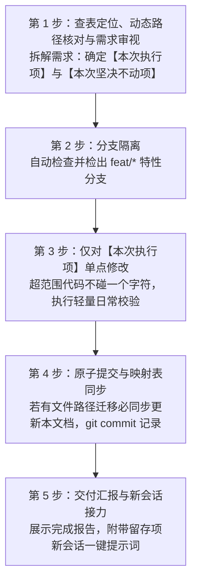

# Bili Player 稳定性单功能隔离开发指南 (MVP 阶段自动推进规范)

> **版本**：v2.3.0 (全局 UI 体系与均衡器音效完备版)  
> **适用说明**：新会话中用户只需告知 Agent：“**请阅读 `docs/ISOLATION_DEV_GUIDE.md`，本次我要修改【功能名称】**”，Agent 必须**严格按照本文档第 1 节的标准协议自动推进全流程**。  
> **核心原则**：**需求审视拆分、符合项单点修改、超范围坚决不动、动态路径校验、轻量验证、安全回退**。

---

## 目录
1. [Agent 新会话自动执行协议 (强制遵照)](#1-agent-新会话自动执行协议-强制遵照)
2. [超细粒度功能模块与文件映射表](#2-超细粒度功能模块与文件映射表)
   - 2.1 [播放控制与音频音效处理 (Playback & DSP)](#21-播放控制与音频音效处理-playback--dsp)
   - 2.2 [歌词系统模块 (Lyrics System)](#22-歌词系统模块-lyrics-system)
   - 2.3 [媒体库与内容浏览模块 (Content & Library)](#23-媒体库与内容浏览模块-content--library)
   - 2.4 [导入与导出模块 (Import & Export)](#24-导入与导出模块-import--export)
   - 2.5 [全局 UI 外观与界面布局模块 (Global UI & Layout)](#25-全局-ui-外观与界面布局模块-global-ui--layout)
   - 2.6 [窗口交互与系统托盘 (Window & System Tray)](#26-窗口交互与系统托盘-window--system-tray)
   - 2.7 [账号体系、网络底层与数据库 (Auth, Network & DB)](#27-账号体系网络底层与数据库-auth-network--db)
3. [模块风险等级与边界防线](#3-模块风险等级与边界防线)
4. [分层轻量校验与构建门禁](#4-分层轻量校验与构建门禁)
5. [故障隔离与回退手册](#5-故障隔离与回退手册)

---

## 1. Agent 新会话自动执行协议 (强制遵照)

当用户在新开启的 Antigravity 会话中发出类似指令时：
> *“请阅读 docs/ISOLATION_DEV_GUIDE.md，本次我需要修改【xxx功能】，具体需求是：……”*

**Agent 必须自动且严格按以下 5 步流水线推进，特别是执行【需求审视】——超范围需求坚决不碰：**



### 自动化执行细则：

#### 第 1 步：查表定位、动态路径核对与需求审视 (Pre-flight Scope Audit)
1. **查表与动态核对**：
   - 对照第 2 节的 [超细粒度功能模块映射表](#2-超细粒度功能模块与文件映射表)，定位目标文件。
   - **动态兜底检查**：Agent 必须核实磁盘上是否存在该物理文件。若文件曾被重命名或迁移导致路径失效，**严禁盲信过期路径**，必须通过代码库检索定位最新路径，并在修改后同步修正本文档第 2 节。
2. **需求分类拆解**：
   - **[本次执行项]**：完全属于当前声明功能范围的改动点，锁定对应的具体代码文件；
   - **[本次坚决不动项]**：超出当前声明功能范围的其他模块需求。
   - **铁律**：**对于不符合当前功能范围的代码，本次绝对不改动任何一个字符！** 确保当前会话的爆炸半径收敛为 0，留存内容由用户开新会话专门处理。

#### 第 2 步：分支隔离 (Branch Isolation)
Agent 自动在终端执行分支检查与创建：
```powershell
Set-Location "G:\Project\Gemini\Bili Player"
git checkout dev
git checkout -b feat/<feature-slug>
```
若分支已存在则直接检出，保证所有修改物理隔离于主线之外。

#### 第 3 步：仅对符合项单点修改与轻量日常校验 (Local Verification)
- 仅对【本次执行项】涉及的目标文件进行针对性改动，保留所有无关注释与现有业务逻辑。
- 修改完成后，触发对应层级的**轻量日常校验**（如 `shared-core` 运行 `pnpm --filter shared-core typecheck`，涉及 Rust 运行 `cargo check`；`desktop` UI 局部调整重点做针对性语法核查）。
- **性能红线**：日常微调严禁频繁执行耗时的整包 `vite build`（耗时 15 秒以上且产生大量磁盘 I/O），`build` 仅留给分支合入前门禁。

#### 第 4 步：原子提交与映射表同步 (Atomic Commit & Table Sync)
- **结构变更同步维护铁律**：若本次修改涉及任何文件的新增、重命名、拆分、移动或删除，**必须在同次提交中同步更新本文档第 2 节的路径映射表**，防止后续会话按陈旧路径改错位置。
- 校验通过后，Agent 自动仅提交变动的目标文件：
```powershell
git add <变动目标文件>
git commit -m "feat(<模块名>): <具体改动描述>"
```

#### 第 5 步：交付汇报与新会话接力提示 (Handoff & Reporting)
在最终汇报中，Agent 必须以清晰结构向用户呈现：
1. **本次已完成修改清单**（涉及的目标文件及逻辑变化）；
2. **当前 Commit ID** 及校验结果；
3. **本次严格未动项与新会话接力模板**：清晰列出被跳过的超范围需求，并附带一段**即拷即用的新会话开场提示词**，方便用户开新会话一键推进。

---

## 2. 超细粒度功能模块与文件映射表

在此查找对应功能，获取其**专属修改文件**与**防破坏红线**。  
*(注：若重构导致文件路径发生变化，提交代码时必须同步更新此表)*

### 2.1 播放控制与音频音效处理 (Playback & DSP)
| 细分子功能 | 专属修改文件 | 风险等级 | 日常校验方式 | 防破坏红线 / 注意事项 |
| :--- | :--- | :---: | :--- | :--- |
| **底栏播放条 UI 与按钮** | `apps/desktop/src/components/layout/BottomPlayerBar.tsx` | [低] | 语法检查 / 合入前 build | 严禁直接改动 `DesktopAudioEngine` 内部状态，仅通过 helper 触发动作。 |
| **播放进度条/音量波浪滑块** | `apps/desktop/src/components/player/WavySlider.tsx` | [低] | 语法检查 / 合入前 build | 保持拖拽松手回调与即时拖动回调的参数一致。 |
| **播放队列与播放模式** | `packages/shared-core/src/stores/useQueueStore.ts` | [高] | `pnpm --filter shared-core typecheck` | 保持循环/单曲/随机三种模式的枚举值兼容，勿丢失持久化字段。 |
| **播放引擎核心与事件** | `apps/desktop/src/audio/DesktopAudioEngine.ts` | [高] | 语法检查 / 合入前 build | 严禁修改已有的事件广播名称（如 `timeupdate`、`track-change` 等）。 |
| **音量响度标准化 (Normalization)** | `apps/desktop/src/audio/DesktopAudioEngine.ts`<br/>`apps/desktop/src/components/views/AudioQualitySettingsCard.tsx` | [中] | 语法检查 / 合入前 build | 保持 Web Audio 节点的 disconnect/connect 释放逻辑，防止内存泄漏。 |
| **10 段专业均衡器与全景环绕音效 (Equalizer & Spatial)** | `apps/desktop/src/components/modals/EqualizerModal.tsx`<br/>`apps/desktop/src/audio/equalizerSettings.ts`<br/>`apps/desktop/src/audio/DesktopAudioEngine.ts`<br/>`apps/desktop/src/audio/SpatialSurroundProcessor.ts` | [中] | 语法检查 / 合入前 build | 严格维持 10 个频段标称频率与增益范围 [-12dB, +12dB]；电脑音箱模式严禁套用耳机 HRTF 滤波器；平滑切换参数避免爆音。 |
| **音质规格档位配置** | `apps/desktop/src/audio/audioSettings.ts`<br/>`packages/shared-core/src/api/bilibili/client.ts` | [中] | `pnpm --filter shared-core typecheck` | 严格保持音质 ID（如 30280、30251 等）与 B 站 API 规格定义一致。 |

### 2.2 歌词系统模块 (Lyrics System)
| 细分子功能 | 专属修改文件 | 风险等级 | 日常校验方式 | 防破坏红线 / 注意事项 |
| :--- | :--- | :---: | :--- | :--- |
| **全屏沉浸歌词与滚动动效** | `apps/desktop/src/components/player/ImmersiveLyricsView.tsx` | [低] | 语法检查 / 合入前 build | 字体缩放动效勿阻塞主线程；保护顶部控制栏显隐逻辑。 |
| **独立透明置顶桌面歌词窗口** | `apps/desktop/src/windows/lyrics/DesktopLyricsApp.tsx`<br/>`apps/desktop/src-tauri/src/window_ext.rs` | [中] | `cargo check` / 合入前 build | 穿透（Ignore Cursor）与锁定状态的同步需维持双向 Tauri 事件通讯。 |
| **在线歌词双平台智能匹配** | `apps/desktop/src/services/lyricService.ts` | [中] | 语法检查 / 合入前 build | 优先检查本地缓存；第三方请求必须有超时熔断机制。 |
| **歌词偏好设置 (字号/模式)** | `apps/desktop/src/components/views/LyricsSettingsCard.tsx`<br/>`apps/desktop/src/components/modals/LyricsSettingsModal.tsx` | [低] | 语法检查 / 合入前 build | 保存至 localStorage 时键名必须维持向下兼容。 |

### 2.3 媒体库与内容浏览模块 (Content & Library)
| 细分子功能 | 专属修改文件 | 风险等级 | 日常校验方式 | 防破坏红线 / 注意事项 |
| :--- | :--- | :---: | :--- | :--- |
| **我的音乐库与自建歌单** | `apps/desktop/src/components/views/LibraryView.tsx` | [低] | 语法检查 / 合入前 build | 歌单增删改查走 shared-core DB 接口，不改动数据库底层表。 |
| **默认收藏夹视图** | `apps/desktop/src/components/views/FavoritesView.tsx` | [低] | 语法检查 / 合入前 build | 收藏状态需与侧边栏以及底部播放栏的红心按钮保持同步。 |
| **追更合集与分 P 选集** | `apps/desktop/src/components/views/CollectionsView.tsx`<br/>`apps/desktop/src/components/modals/VideoPartsModal.tsx` | [低] | 语法检查 / 合入前 build | 分 P 列表多选与批量播放逻辑保持轻量。 |
| **收听足迹与热度日历分布** | `apps/desktop/src/components/views/HistoryHeatmapView.tsx`<br/>`packages/shared-core/src/stores/useHistoryStore.ts` | [中] | `pnpm --filter shared-core typecheck` | 日期筛选与热度矩阵跳转算法勿破坏已有的按天聚合数据结构。 |
| **本地歌曲扫描与管理** | `apps/desktop/src/components/views/LocalMusicView.tsx`<br/>`apps/desktop/src-tauri/src/local_scanner.rs` | [中] | `cargo check` / 合入前 build | 文件夹递归扫描与 ID3 元数据解析需做好大文件容错。 |
| **B 站全网音视频检索** | `apps/desktop/src/components/views/SearchView.tsx`<br/>`packages/shared-core/src/api/bilibili/api.ts` | [中] | `pnpm --filter shared-core typecheck` | 搜索调用必须带 WBI 签名，严格禁止移除防抖（Debounce）。 |

### 2.4 导入与导出模块 (Import & Export)
| 细分子功能 | 专属修改文件 | 风险等级 | 日常校验方式 | 防破坏红线 / 注意事项 |
| :--- | :--- | :---: | :--- | :--- |
| **外部歌单智能匹配与导入** | `apps/desktop/src/components/modals/PlaylistImportModal.tsx`<br/>`packages/shared-core/src/api/matcher/externalPlaylist.ts` | [中] | `pnpm --filter shared-core typecheck` | **严禁移除 `MIN_DELAY` 延迟与串行处理，必须带 `skipCookie: true` 防封号防封IP**。 |
| **歌单文本清洗与打分模型** | `packages/shared-core/src/api/matcher/matching.ts` | [低] | `pnpm --filter shared-core typecheck` | 维持时长高斯打分与 LCS 编辑距离算子的纯函数特性。 |
| **单曲/批量高清音频导出** | `apps/desktop/src/components/modals/BatchExportModal.tsx`<br/>`apps/desktop/src/components/modals/ExportTrackModal.tsx`<br/>`apps/desktop/src-tauri/src/exporter.rs` | [高] | `cargo check` / 合入前 build | 保留无损容器 remux 解封装合并，避免重编码导致音质降级。 |

### 2.5 全局 UI 外观与界面布局模块 (Global UI & Layout)
| 细分子功能 | 专属修改文件 | 风险等级 | 日常校验方式 | 防破坏红线 / 注意事项 |
| :--- | :--- | :---: | :--- | :--- |
| **全局主布局与视图挂载骨架** | `apps/desktop/src/components/layout/MainLayout.tsx`<br/>`apps/desktop/src/App.tsx` | [低] | 语法检查 / 合入前 build | 确保各视图 Tab 挂载生命周期正常，避免主内容区容器滚动穿透。 |
| **导航侧边栏 (Sidebar)** | `apps/desktop/src/components/layout/Sidebar.tsx` | [低] | 语法检查 / 合入前 build | 保证折叠/展开动画平滑，导航选中项高亮与当前激活 Tab 一致。 |
| **自定义标题栏与原生拖拽** | `apps/desktop/src/components/layout/TitleBar.tsx` | [低] | 语法检查 / 合入前 build | 保持 `data-tauri-drag-region` 拖拽属性完整；窗口最小化/最大化/关闭事件正常响应。 |
| **沉浸流体动效背景 (Fluid Background)** | `apps/desktop/src/components/player/FluidBackground.tsx` | [低] | 语法检查 / 合入前 build | 维持 Canvas/CSS 色彩过渡性能，低配机器上避免过度占用 GPU/CPU。 |
| **全局样式、主题变量与暗色基调** | `apps/desktop/src/styles/globals.css`<br/>`apps/desktop/tailwind.config.js` | [低] | 语法检查 / 合入前 build | 保持 CSS 变量命名契约；滚动条美化样式与全局深色基调一致。 |
| **装扮换肤与动态壁纸存储** | `apps/desktop/src/components/views/SkinStoreView.tsx`<br/>`apps/desktop/src/utils/wallpaperStorage.ts`<br/>`packages/shared-core/src/stores/useSkinStore.ts` | [低] | 语法检查 / 合入前 build | 壁纸 Base64/Blob 本地持久化限制体积，防止 localStorage 溢出。 |
| **歌单操作交互弹窗体系 (Modals)** | `apps/desktop/src/components/modals/AddToPlaylistModal.tsx`<br/>`apps/desktop/src/components/modals/CreatePlaylistModal.tsx`<br/>`apps/desktop/src/components/modals/EditPlaylistModal.tsx`<br/>`apps/desktop/src/components/modals/ReplaceTrackModal.tsx` | [低] | 语法检查 / 合入前 build | 维持弹窗蒙层点击关闭与 ESC 退出交互一致性；表单校验输入防空。 |

### 2.6 窗口交互与系统托盘 (Window & System Tray)
| 细分子功能 | 专属修改文件 | 风险等级 | 日常校验方式 | 防破坏红线 / 注意事项 |
| :--- | :--- | :---: | :--- | :--- |
| **Mini 胶囊悬浮小窗** | `apps/desktop/src/windows/mini/MiniPlayerApp.tsx`<br/>`apps/desktop/src-tauri/src/window_ext.rs` | [中] | `cargo check` / 合入前 build | 维持 Mini 模式与主窗口互斥展开收起状态机。 |
| **系统托盘与右键菜单** | `apps/desktop/src/windows/tray/TrayMenuApp.tsx`<br/>`apps/desktop/src-tauri/src/lib.rs` | [中] | `cargo check` / 合入前 build | 保持失去焦点时自动隐藏窗口的 Win32 事件监听。 |
| **全局快捷键响应与配置** | `apps/desktop/src/components/views/ShortcutsSettingsView.tsx`<br/>`apps/desktop/src-tauri/src/shortcuts.rs` | [中] | `cargo check` / 合入前 build | 避免单键与系统组合键冲突，处理快捷键被占用时的错误回退。 |
| **开机自启动设置** | `apps/desktop/src/components/views/SettingsView.tsx`<br/>`apps/desktop/src-tauri/src/window_ext.rs` | [中] | `cargo check` / 合入前 build | 注册表操作必须使用静默后台子进程，不弹任何 CMD 黑框。 |
| **窗口圆角与毛玻璃原生特效** | `apps/desktop/src-tauri/src/window_ext.rs` | [极高] | `cargo check` | 涉及 Windows Win32 API 与 DwmSetWindowAttribute，非必要绝不改动。 |

### 2.7 账号体系、网络底层与数据库 (Auth, Network & DB)
| 细分子功能 | 专属修改文件 | 风险等级 | 日常校验方式 | 防破坏红线 / 注意事项 |
| :--- | :--- | :---: | :--- | :--- |
| **B 站扫码登录与凭证保存** | `apps/desktop/src/components/modals/LoginModal.tsx`<br/>`apps/desktop/src/services/loginQrService.ts`<br/>`packages/shared-core/src/stores/useAuthStore.ts` | [高] | `pnpm --filter shared-core typecheck` | 保持轮询超时与二维码状态自动销毁机制。 |
| **WBI 加盐加密防反爬核心** | `packages/shared-core/src/api/bilibili/wbi.ts` | [极高] | `pnpm --filter shared-core typecheck` | 保持 B 站官方字符打乱编码与时间戳加签算式绝对一致。 |
| **本地环回音频流代理** | `apps/desktop/src-tauri/src/stream_proxy.rs` | [极高] | `cargo check` | 严格保证本地 127.0.0.1 代理服务器的防盗链 Referer 伪造与 Range 缓存分块逻辑。 |
| **存储缓存管理与清理** | `apps/desktop/src/components/views/CacheSettingsCard.tsx`<br/>`apps/desktop/src-tauri/src/window_ext.rs` | [中] | `cargo check` / 合入前 build | 递归计算缓存目录大小必须异步执行，清理时避免误删运行中数据库。 |
| **SQLite 数据库表结构与 CRUD** | `packages/shared-core/src/db/` | [高] | `pnpm --filter shared-core typecheck` | 新增字段必须使用可选字段与平滑迁移，严禁删除已有用户数据列。 |

---

## 3. 模块风险等级与边界防线

每次修改前根据功能所处级别采取对应的防范措施：

- **[低] 低风险 (安全区)**：自包含在单独 `.tsx` 内部，只动局部 state/JSX/Tailwind，严禁改动外部 Props 接口定义。
- **[中] 中风险 (受控区)**：涉及辅助服务或跨端逻辑，必须保持输入输出类型不变；涉及第三方网络请求严格保留防风控节流参数。
- **[高] 高风险 (核心区)**：涉及全局状态（Zustand）、数据持久化（SQLite）或音频主引擎，必须提供默认值容错，禁止直接破坏既有结构。
- **[极高] 极高风险 (原子区)**：涉及 Tauri 底层 Rust 代码、WBI 核心签名或环回代理服务，必须经过严谨语法校验，禁止随意重构。

---

## 4. 分层轻量校验与构建门禁

日常单功能开发与特性合入区分两套检验机制，**杜绝日常开发频繁全包构建**：

### 4.1 日常单功能快速校验 (秒级轻量，单点修改后触发)
```powershell
# 1. 仅修改 shared-core 数据模型、API 或 store 时 (纯类型推导，约 2 秒)
Set-Location "G:\Project\Gemini\Bili Player"; pnpm --filter shared-core typecheck

# 2. 涉及 Rust 后端修改时 (只检查语法不生成产物，约 2~3 秒)
cmd /c "call D:\VS\VC\Auxiliary\Build\vcvars64.bat && cd /d G:\Project\Gemini\Bili Player\apps\desktop\src-tauri && cargo check"

# 3. 仅修改前端 UI/组件时
# 进行文件语法核对，避免每次微调都跑整包打包。
```

### 4.2 特性分支合入前门禁校验 (Pre-merge Gate，准备合入主线/提 PR 前执行)
```powershell
# 前端全量静态打包与资源完整性验证 (Vite 整包构建，约 12~15 秒)
Set-Location "G:\Project\Gemini\Bili Player"; pnpm --filter desktop build
```

### 4.3 全量出厂 Release 编译打包 (全量组装，仅在发版总会话中执行)
```powershell
# 全套 MSVC 深度优化、Rust 原生编译与二进制安装包封装 (约 50~90 秒)
cmd /c "call D:\VS\VC\Auxiliary\Build\vcvars64.bat && cd /d G:\Project\Gemini\Bili Player && pnpm --filter desktop tauri build"
```

---

## 5. 故障隔离与回退手册

如遇修改不符合预期或引入偶发 Bug，可立即执行以下命令瞬间复原：

```powershell
# 方案 1：仅撤销单个文件的误改
git checkout -- <file-path>

# 方案 2：利用提交 Commit ID 秒级强制穿梭回稳定点
git reset --hard <STABLE_COMMIT_ID>

# 方案 3：直接丢弃整个异常的临时特性分支
git checkout dev
git branch -D feat/<failed-feature-name>
```

---
*本规范文档为 Antigravity 自动化单功能迭代的标准驱动协议，日常迭代中请严格依此推进。*
