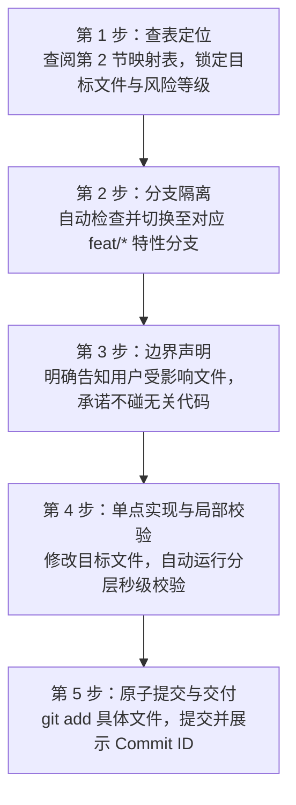

# Bili Player 稳定性单功能隔离开发指南 (MVP 阶段自动推进规范)

> **版本**：v2.0.0 (MVP 自动推进版)  
> **适用说明**：新会话中用户只需告知 Agent：“**请阅读 `docs/ISOLATION_DEV_GUIDE.md`，本次我要修改【功能名称】**”，Agent 必须**严格按照本文档第 1 节的标准协议自动推进全流程**。  
> **核心原则**：**单点修改、最小爆炸半径、精准查表、自动校验、安全回退**。

---

## 目录
1. [🤖 Agent 新会话自动执行协议 (强制遵照)](#1--agent-新会话自动执行协议-强制遵照)
2. [🗺️ 超细粒度功能模块与文件映射表](#2-️-超细粒度功能模块与文件映射表)
3. [🛡️ 模块风险等级与边界防线](#3-️-模块风险等级与边界防线)
4. [⚡ 分层秒级校验与测试矩阵](#4--分层秒级校验与测试矩阵)
5. [🔄 故障隔离与秒级回退手册](#5--故障隔离与秒级回退手册)

---

## 1. 🤖 Agent 新会话自动执行协议 (强制遵照)

当用户在新开启的 Antigravity 会话中发出类似指令时：
> *“请阅读 docs/ISOLATION_DEV_GUIDE.md，本次我需要修改【xxx功能】”*

**Agent 必须自动且严格按以下 5 步标准化流水线推进，严禁跳步或任意泛化修改：**



### 自动化执行细则：

1. **第 1 步：查表定位（Target Identification）**
   - 立即检索本文档第 2 节的 [超细粒度功能模块映射表](#2-️-超细粒度功能模块与文件映射表)，定位用户指定功能对应的：
     - **目标代码文件路径**（严格限定范围）；
     - **风险等级**（🟢 低风险 / 🟡 中风险 / 🔴 高风险 / ⛔ 极高风险）；
     - **禁止改动的关联依赖**。
2. **第 2 步：分支隔离（Branch Isolation）**
   - Agent 自动在终端执行分支检查：
     ```powershell
     Set-Location "G:\Project\Gemini\Bili Player"
     git checkout dev
     git checkout -b feat/<feature-slug>
     ```
   - 若已有同名分支则直接检出，确保修改不会直接落入主分支。
3. **第 3 步：边界声明（Scope Declaration）**
   - 在开始编码前，用简炼的语言向用户声明：
     - 本次操作的目标文件清单；
     - 承诺**绝不修改清单之外的任何文件**；
     - 采取的兼容性保护措施。
4. **第 4 步：单点修改与自动校验（Local Verification）**
   - 仅对目标文件进行精细化修改，保留所有无关注释与逻辑。
   - 修改完成后，**自动根据所属层级执行秒级校验**（前端仅跑 `pnpm --filter desktop build`，后端仅跑 `cargo check`，**绝不可盲目全量打包**）。
5. **第 5 步：原子提交与交付（Atomic Commit & Reporting）**
   - 校验通过后，自动仅添加变动的文件并提交：
     ```powershell
     git add <目标文件1> <目标文件2>
     git commit -m "feat(<模块名>): <具体改动简述>"
     ```
   - 向用户清晰汇报：**修改完成说明、当前 Commit ID、校验结果**，并询问用户是否验收合并回 `dev`。

---

## 2. 🗺️ 超细粒度功能模块与文件映射表

在此查找对应功能，获取其**专属目标文件**与**防破坏红线**：

### 2.1 播放控制与播放栏模块
| 细分子功能 | 专属修改文件 | 风险等级 | 对应校验命令 | 防破坏红线 / 注意事项 |
| :--- | :--- | :---: | :--- | :--- |
| **底栏播放条 UI 与按钮** | `apps/desktop/src/components/layout/BottomPlayerBar.tsx` | 🟢 低 | `pnpm --filter desktop build` | 严禁直接改动 `DesktopAudioEngine` 内部状态，仅通过 helper 触发动作。 |
| **播放进度条/音量波浪滑块** | `apps/desktop/src/components/player/WavySlider.tsx` | 🟢 低 | `pnpm --filter desktop build` | 保持拖拽松手回调与即时拖动回调的参数一致。 |
| **播放队列与播放模式** | `packages/shared-core/src/stores/useQueueStore.ts` | 🔴 高 | `pnpm --filter shared-core build` | 保持循环/单曲/随机三种模式的枚举值兼容，勿丢失持久化字段。 |
| **播放引擎核心与事件** | `apps/desktop/src/audio/DesktopAudioEngine.ts` | 🔴 高 | `pnpm --filter desktop build` | 严禁修改已有的事件广播名称（如 `timeupdate`、`track-change` 等）。 |
| **音量响度标准化 (Normalization)** | `apps/desktop/src/audio/DesktopAudioEngine.ts`<br/>`apps/desktop/src/components/views/AudioQualitySettingsCard.tsx` | 🟡 中 | `pnpm --filter desktop build` | 保持 Web Audio 节点的 disconnect/connect 释放逻辑，防止内存泄漏。 |
| **音质规格档位配置** | `apps/desktop/src/audio/audioSettings.ts`<br/>`packages/shared-core/src/api/bilibili/client.ts` | 🟡 中 | `pnpm --filter desktop build` | 严格保持音质 ID（如 30280、30251 等）与 B 站 API 规格定义一致。 |

### 2.2 歌词系统模块
| 细分子功能 | 专属修改文件 | 风险等级 | 对应校验命令 | 防破坏红线 / 注意事项 |
| :--- | :--- | :---: | :--- | :--- |
| **全屏沉浸歌词与滚动动效** | `apps/desktop/src/components/player/ImmersiveLyricsView.tsx` | 🟢 低 | `pnpm --filter desktop build` | 字体缩放动效勿阻塞主线程；保护顶部控制栏显隐逻辑。 |
| **独立透明置顶桌面歌词窗口** | `apps/desktop/src/windows/lyrics/DesktopLyricsApp.tsx`<br/>`apps/desktop/src-tauri/src/window_ext.rs` | 🟡 中 | 前端 build + `cargo check` | 穿透（Ignore Cursor）与锁定状态的同步需维持双向 Tauri 事件通讯。 |
| **在线歌词双平台智能匹配** | `apps/desktop/src/services/lyricService.ts` | 🟡 中 | `pnpm --filter desktop build` | 优先检查本地缓存；第三方请求必须有超时熔断机制。 |
| **歌词偏好设置 (字号/模式)** | `apps/desktop/src/components/views/LyricsSettingsCard.tsx` | 🟢 低 | `pnpm --filter desktop build` | 保存至 localStorage 时键名必须维持向下兼容。 |

### 2.3 媒体库与内容浏览模块
| 细分子功能 | 专属修改文件 | 风险等级 | 对应校验命令 | 防破坏红线 / 注意事项 |
| :--- | :--- | :---: | :--- | :--- |
| **我的音乐库与自建歌单** | `apps/desktop/src/components/views/LibraryView.tsx` | 🟢 低 | `pnpm --filter desktop build` | 歌单增删改查走 shared-core DB 接口，不改动数据库底层表。 |
| **默认收藏夹视图** | `apps/desktop/src/components/views/FavoritesView.tsx` | 🟢 低 | `pnpm --filter desktop build` | 收藏状态需与侧边栏以及底部播放栏的红心按钮保持同步。 |
| **追更合集与分 P 选集** | `apps/desktop/src/components/views/CollectionsView.tsx`<br/>`apps/desktop/src/components/modals/VideoPartsModal.tsx` | 🟢 低 | `pnpm --filter desktop build` | 分 P 列表多选与批量播放逻辑保持轻量。 |
| **收听足迹与热度日历分布** | `apps/desktop/src/components/views/HistoryHeatmapView.tsx`<br/>`packages/shared-core/src/stores/useHistoryStore.ts` | 🟡 中 | `pnpm --filter desktop build` | 日期筛选与热度矩阵跳转算法勿破坏已有的按天聚合数据结构。 |
| **本地歌曲扫描与管理** | `apps/desktop/src/components/views/LocalMusicView.tsx`<br/>`apps/desktop/src-tauri/src/local_scanner.rs` | 🟡 中 | 前端 build + `cargo check` | 文件夹递归扫描与 ID3 元数据解析需做好大文件容错。 |
| **B 站全网音视频检索** | `apps/desktop/src/components/views/SearchView.tsx`<br/>`packages/shared-core/src/api/bilibili/api.ts` | 🟡 中 | `pnpm --filter desktop build` | 搜索调用必须带 WBI 签名，严格禁止移除防抖（Debounce）。 |
| **侧边栏导航与主框架** | `apps/desktop/src/components/layout/MainLayout.tsx`<br/>`apps/desktop/src/components/layout/TitleBar.tsx` | 🟢 低 | `pnpm --filter desktop build` | 视图 Tab 切换与窗口控制按钮（最小化/最大化/关闭）逻辑保持独立。 |

### 2.4 导入与导出模块
| 细分子功能 | 专属修改文件 | 风险等级 | 对应校验命令 | 防破坏红线 / 注意事项 |
| :--- | :--- | :---: | :--- | :--- |
| **外部歌单智能匹配与导入** | `apps/desktop/src/components/modals/PlaylistImportModal.tsx`<br/>`packages/shared-core/src/api/matcher/externalPlaylist.ts` | 🟡 中 | `pnpm --filter desktop build` | **严禁移除 `MIN_DELAY` 延迟与串行处理，必须带 `skipCookie: true` 防封号防封IP**。 |
| **歌单文本清洗与打分模型** | `packages/shared-core/src/api/matcher/matching.ts` | 🟢 低 | `pnpm --filter shared-core build` | 维持时长高斯打分与 LCS 编辑距离算子的纯函数特性。 |
| **单曲/批量高清音频导出** | `apps/desktop/src/components/modals/BatchExportModal.tsx`<br/>`apps/desktop/src/components/modals/ExportTrackModal.tsx`<br/>`apps/desktop/src-tauri/src/exporter.rs` | 🔴 高 | 前端 build + `cargo check` | 保留无损容器 remux 解封装合并，避免重编码导致音质降级。 |

### 2.5 窗口交互与系统托盘
| 细分子功能 | 专属修改文件 | 风险等级 | 对应校验命令 | 防破坏红线 / 注意事项 |
| :--- | :--- | :---: | :--- | :--- |
| **Mini 胶囊悬浮小窗** | `apps/desktop/src/windows/mini/MiniPlayerApp.tsx`<br/>`apps/desktop/src-tauri/src/window_ext.rs` | 🟡 中 | 前端 build + `cargo check` | 维持 Mini 模式与主窗口互斥展开收起状态机。 |
| **系统托盘与右键菜单** | `apps/desktop/src/windows/tray/TrayMenuApp.tsx`<br/>`apps/desktop/src-tauri/src/lib.rs` | 🟡 中 | 前端 build + `cargo check` | 保持失去焦点时自动隐藏窗口的 Win32 事件监听。 |
| **全局快捷键响应与配置** | `apps/desktop/src/components/views/ShortcutsSettingsView.tsx`<br/>`apps/desktop/src-tauri/src/shortcuts.rs` | 🟡 中 | 前端 build + `cargo check` | 避免单键与系统组合键冲突，处理快捷键被占用时的错误回退。 |
| **开机自启动设置** | `apps/desktop/src/components/views/SettingsView.tsx`<br/>`apps/desktop/src-tauri/src/window_ext.rs` | 🟡 中 | 前端 build + `cargo check` | 注册表操作必须使用静默后台子进程，不弹任何 CMD 黑框。 |
| **窗口圆角与毛玻璃原生特效** | `apps/desktop/src-tauri/src/window_ext.rs` | ⛔ 极高 | `cargo check` | 涉及 Windows Win32 API 与 DwmSetWindowAttribute，非必要绝不改动。 |

### 2.6 账号体系、网络底层与数据库
| 细分子功能 | 专属修改文件 | 风险等级 | 对应校验命令 | 防破坏红线 / 注意事项 |
| :--- | :--- | :---: | :--- | :--- |
| **B 站扫码登录与凭证保存** | `apps/desktop/src/components/modals/LoginModal.tsx`<br/>`apps/desktop/src/services/loginQrService.ts`<br/>`packages/shared-core/src/stores/useAuthStore.ts` | 🔴 高 | `pnpm --filter desktop build` | 保持轮询超时与二维码状态自动销毁机制。 |
| **WBI 加盐加密防反爬核心** | `packages/shared-core/src/api/bilibili/wbi.ts` | ⛔ 极高 | `pnpm --filter shared-core build` | 保持 B 站官方字符打乱编码与时间戳加签算式绝对一致。 |
| **本地环回音频流代理** | `apps/desktop/src-tauri/src/stream_proxy.rs` | ⛔ 极高 | `cargo check` | 严格保证本地 127.0.0.1 代理服务器的防盗链 Referer 伪造与 Range 缓存分块逻辑。 |
| **存储缓存管理与清理** | `apps/desktop/src/components/views/CacheSettingsCard.tsx`<br/>`apps/desktop/src-tauri/src/window_ext.rs` | 🟡 中 | 前端 build + `cargo check` | 递归计算缓存目录大小必须异步执行，清理时避免误删运行中数据库。 |
| **SQLite 数据库表结构与 CRUD** | `packages/shared-core/src/db/` | 🔴 高 | `pnpm --filter shared-core build` | 新增字段必须使用可选字段与平滑迁移，严禁删除已有用户数据列。 |
| **主题换肤与色板** | `apps/desktop/src/components/views/SkinStoreView.tsx` | 🟢 低 | `pnpm --filter desktop build` | 纯 CSS 变量与 Tailwind 类动态绑定，勿修改非换肤容器。 |

---

## 3. 🛡️ 模块风险等级与边界防线

每次修改前根据功能所处级别采取对应的防范措施：

- 🟢 **低风险 (安全区)**：自包含在单独 `.tsx` 内部，只动局部 state/JSX/Tailwind，严禁改动外部 Props 接口定义。
- 🟡 **中风险 (受控区)**：涉及辅助服务或跨端逻辑，必须保持输入输出类型不变；涉及第三方网络请求严格保留防风控节流参数。
- 🔴 **高风险 (核心区)**：涉及全局状态（Zustand）、数据持久化（SQLite）或音频主引擎，必须提供默认值容错，禁止直接破坏既有结构。
- ⛔ **极高风险 (原子区)**：涉及 Tauri 底层 Rust 代码、WBI 核心签名或环回代理服务，必须经过严谨语法校验，禁止随意重构。

---

## 4. ⚡ 分层秒级校验与测试矩阵

日常单功能开发严禁使用耗时的全量打包，**按需选用对应秒级校验**：

```powershell
# 1. 仅修改前端 UI/组件时 (约 5 秒)
pnpm --filter desktop build

# 2. 仅修改 shared-core 数据或 API 时 (约 3 秒)
pnpm --filter shared-core build

# 3. 涉及 Rust 后端修改时 (约 2 秒)
cmd /c "call D:\VS\VC\Auxiliary\Build\vcvars64.bat && cd /d G:\Project\Gemini\Bili Player\apps\desktop\src-tauri && cargo check"

# 4. 全功能验收通过后的最终 Release 编译打包 (约 50 秒)
cmd /c "call D:\VS\VC\Auxiliary\Build\vcvars64.bat && cd /d G:\Project\Gemini\Bili Player && pnpm --filter desktop tauri build"
```

---

## 5. 🔄 故障隔离与秒级回退手册

如遇修改不符合预期或引入偶发 Bug，可立即执行以下命令瞬间复原：

```powershell
# 方案 1：仅撤销单个文件的误改
git checkout -- <file-path>

# 方案 2：利用提交 Commit ID 秒级强制穿梭回稳定点
git reset --hard <STABLE_COMMIT_ID>

# 方案 3：直接丢弃整个异常的临时特性分支
git checkout dev
git branch -D feat/<failed-feature-name>
```

---
*本规范文档为 Antigravity 自动化单功能迭代的标准驱动协议，日常迭代中请严格依此推进。*
