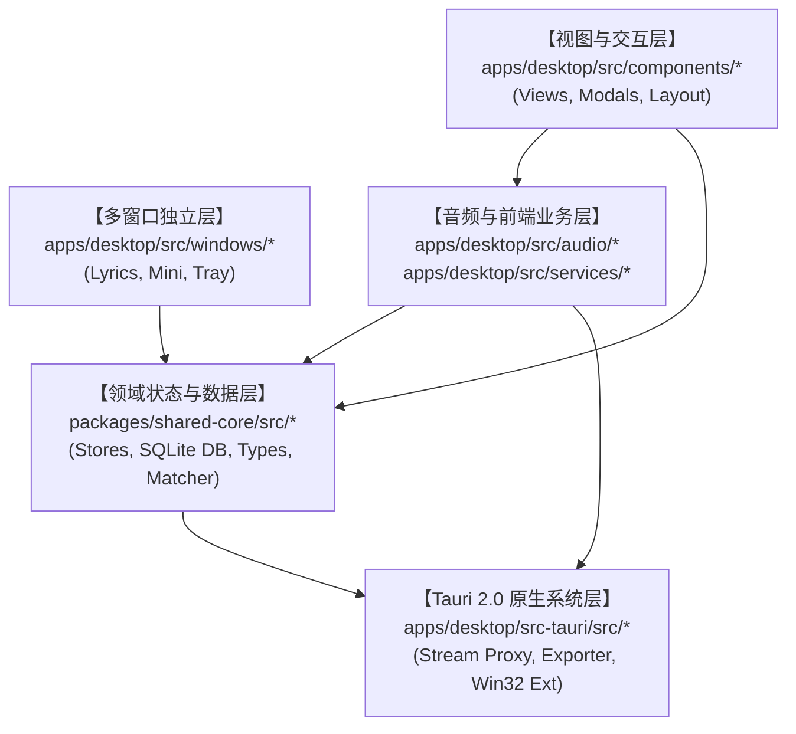
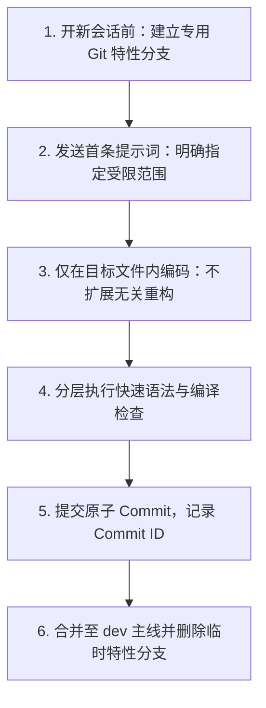

# Bili Player 稳定性单功能隔离开发指南 (MVP 阶段规范)

> **版本**：v1.1.0  
> **适用阶段**：项目已进入 MVP 稳定运行期，后续所有功能迭代、Bug 修复及 UI 优化必须遵循本规范。  
> **核心原则**：**单点修改、最小爆炸半径、强类型约束、可控回退**。

---

## 目录
1. [系统全景拓扑与模块分类](#1-系统全景拓扑与模块分类)
2. [模块风险等级与修改爆炸半径](#2-模块风险等级与修改爆炸半径)
3. [六大常见开发场景隔离指引](#3-六大常见开发场景隔离指引)
4. [新会话单功能开发 SOP (标准操作流程)](#4-新会话单功能开发-sop-标准操作流程)
5. [分层轻量校验与构建矩阵](#5-分层轻量校验与构建矩阵)
6. [故障隔离与回退机制 (Rollback Playbook)](#6-故障隔离与回退机制-rollback-playbook)

---

## 1. 系统全景拓扑与模块分类

整个代码库基于 **pnpm Monorepo + Tauri 2.0 原生多进程** 架构设计，共划分为四大层级：



### 模块详细清单与职能边界

| 分类层级 | 对应路径 | 核心文件 / 模块 | 职责说明 |
| :--- | :--- | :--- | :--- |
| **A. 视图表现层 (Views & Layout)** | `apps/desktop/src/components/views/`<br/>`apps/desktop/src/components/layout/` | `LibraryView.tsx`<br/>`SettingsView.tsx`<br/>`HistoryHeatmapView.tsx`<br/>`BottomPlayerBar.tsx` | 各功能页面展示、列表渲染、按钮交互、用户操作分发，不直接包含网络请求算法或底层文件 IO。 |
| **B. 弹窗与交互层 (Modals)** | `apps/desktop/src/components/modals/` | `PlaylistImportModal.tsx`<br/>`BatchExportModal.tsx`<br/>`LoginModal.tsx` | 模态弹窗、表单输入、导出配置、登录扫码弹窗。与主界面松耦合，仅通过 Props/回调通信。 |
| **C. 多窗口体系 (Windows)** | `apps/desktop/src/windows/` | `lyrics/DesktopLyricsApp.tsx`<br/>`mini/MiniPlayerApp.tsx`<br/>`tray/TrayMenuApp.tsx` | 独立 Webview 实例（桌面歌词、Mini 悬浮窗、托盘菜单），通过 Tauri Event 监听全局播放状态与动作。 |
| **D. 前端播放引擎层 (Audio Engine)** | `apps/desktop/src/audio/`<br/>`apps/desktop/src/services/` | `DesktopAudioEngine.ts`<br/>`audioSettings.ts`<br/>`lyricService.ts` | HTML5 Audio / Web Audio API 处理、音量均衡归一化、格式解析、双平台在线歌词获取。 |
| **E. 共享数据与接口层 (Shared Core)** | `packages/shared-core/src/` | `api/bilibili/` (WBI签名/API)<br/>`api/matcher/` (歌曲匹配)<br/>`stores/` (Zustand状态)<br/>`db/` (SQLite 数据库) | 跨端通用的领域逻辑、数据模型定义、B 站 WBI 鉴权、网易云/QQ 歌单适配、本地 SQLite 表结构及增删改查。 |
| **F. 原生系统能力层 (Tauri Core)** | `apps/desktop/src-tauri/src/` | `lib.rs` (命令路由)<br/>`window_ext.rs` (窗口/注册表)<br/>`stream_proxy.rs` (本地流代理)<br/>`exporter.rs` (无损容器导出) | Rust 编写的原生核心：Windows 注册表开机自启、窗口特效、环回代理服务器（解防盗链与分块缓存）、音频原生解封装与重打包。 |

---

## 2. 模块风险等级与修改爆炸半径

进行需求评估时，首先判定该功能所属模块的风险等级，严格限制修改波及面：

| 风险等级 | 所属模块 | 潜在破坏后果 | 隔离规则 |
| :---: | :--- | :--- | :--- |
| 🟢 **低风险**<br/>(安全区) | • `components/views/*`<br/>• `components/modals/*`<br/>• `styles/*` | 仅影响单一 UI 样式或局部弹窗展示，不会造成数据丢失或崩溃。 | • 仅在当前组件文件内做自包含修改。<br/>• 禁止在 UI 组件中直接修改全局 Store 的底层 Schema。 |
| 🟡 **中风险**<br/>(受控区) | • `services/lyricService.ts`<br/>• `api/matcher/*`<br/>• `audio/audioSettings.ts` | 可能导致歌词不匹配、歌单导入速度变慢、音质切换异常。 | • 保持接口入参与返回值类型签名不变。<br/>• 对任何网络请求严格保留延时防风控参数。 |
| 🔴 **高风险**<br/>(核心区) | • `packages/shared-core/src/stores/*`<br/>• `packages/shared-core/src/db/*`<br/>• `audio/DesktopAudioEngine.ts` | 可能引发跨多组件的级联渲染异常、播放进度不同步、本地数据库读取失败。 | • **禁止直接重构数据结构**。<br/>• 如需新增字段，必须采用**可选字段 (`?`)** 或默认值兼容策略。 |
| ⛔ **极高风险**<br/>(原子区) | • `apps/desktop/src-tauri/src/*`<br/>• `shared-core/src/api/bilibili/wbi.ts` | 应用程序启动失败、CORS 拦截、B 站 IP 封禁、全屏无边框拖拽失效。 | • 必须经过 `cargo check` 零告警校验。<br/>• 禁止在没有明确需求时改动 `stream_proxy.rs` 的端口或请求头规则。 |

---

## 3. 六大常见开发场景隔离指引

### 场景 1：仅修改某个页面或组件的 UI 样式/布局
- **受影响文件**：对应视图文件（如 `LibraryView.tsx` 或 `SettingsView.tsx`）。
- **隔离守则**：
  1. 仅限在该 `.tsx` 内部增删 Tailwind 类名或局部 State。
  2. 严禁改动组件上游传入的 `Props` 接口定义，除非所有父级调用方已做好向下兼容。
  3. 严禁改动全局 `globals.css` 中已有的全局原子规则。

### 场景 2：在偏好设置中增加一个新的系统/行为开关
- **受影响文件**：
  - 前端：`SettingsView.tsx`（新增选项卡片与状态）
  - 后端：`apps/desktop/src-tauri/src/window_ext.rs`（增加 Tauri 接口）、`lib.rs`（注册路由）
- **隔离守则**：
  1. 后端新增的命令必须设置安全默认值（如未配置时默认返回 `false`）。
  2. 前端组件挂载时通过 `.catch()` 兜底捕获异常，确保即便后端命令未生效，设置界面依然能平稳降级渲染。

### 场景 3：调整歌词呈现或在线匹配算法
- **受影响文件**：`apps/desktop/src/services/lyricService.ts`、`packages/shared-core/src/api/matcher/`。
- **隔离守则**：
  1. **绝对禁止移除节流保护**（`MIN_DELAY` 与串行请求机制），防风控是整个外链导入的基石。
  2. 对外输出的 `LyricLine` 或匹配结果对象结构必须保持不变。

### 场景 4：修改音频播放或音量引擎
- **受影响文件**：`apps/desktop/src/audio/DesktopAudioEngine.ts`。
- **隔离守则**：
  1. 音频引擎是整个播放器的生命线，修改时严禁改动现有的事件广播名（如 `track-change`、`timeupdate`、`play-state`）。
  2. 涉及 Web Audio 滤镜或增益调节，必须保留全局静音、快速切歌时的旧 Source 释放（`disconnect()` / `stop()`）逻辑，防止音频内存泄露。

### 场景 5：修改或新增 B 站 API
- **受影响文件**：`packages/shared-core/src/api/bilibili/`。
- **隔离守则**：
  1. 所有敏感搜索接口统一走 `wbi.ts` 的 `getWbiEncodedParams` 签名。
  2. 批量非关键查询必须保留 `skipCookie: true`，严格隔离用户主账号风险。

### 场景 6：更新本地 SQLite 数据库字段
- **受影响文件**：`packages/shared-core/src/db/`。
- **隔离守则**：
  1. 严禁直接修改已有表的列类型或删除已有列（会导致老用户本地数据库无法读取）。
  2. 必须使用 `ALTER TABLE ... ADD COLUMN` 进行增量字段平滑迁移，并提供 `DEFAULT` 初始值。

---

## 4. 新会话单功能开发 SOP (标准操作流程)

当开启新的 Antigravity 会话进行特定功能开发时，请严格按照以下标准流程推进：



### 步骤详解

#### 阶段 1：分支隔离（开新会话前）
在终端中从 `dev` 检出专属特性分支：
```powershell
Set-Location "G:\Project\Gemini\Bili Player"
git checkout dev
git pull
git checkout -b feat/<your-feature-name>
```

#### 阶段 2：输入新会话精准提示词（开新会话首条消息）
向新会话发送如下约束模板：
```text
你好！我们在 feat/<your-feature-name> 分支上进行开发。
本次任务目标：【详细描述具体修改项】
【受限边界要求】：
1. 范围限定：仅允许修改与本功能直接相关的目标文件【列出目标文件/目录】，严禁改动其他模块。
2. 稳定性优先：保持接口入参、返回值与现有调用方 100% 向下兼容。
3. 验证步骤：修改后仅执行局部类型检查与编译，不可盲目全量打包。
4. 提交规范：确认无误后使用 Git 提交并提示 Commit ID。
```

#### 阶段 3：原子提交（开发完成）
每次功能点实现后，只 `git add` 变动文件：
```powershell
git add <target-file-1> <target-file-2>
git commit -m "feat(scope): descriptive summary"
```

#### 阶段 4：主线合并（合并验证）
```powershell
git checkout dev
git merge feat/<your-feature-name>
git branch -d feat/<your-feature-name>
```

---

## 5. 分层轻量校验与构建矩阵

日常开发中，**严禁频繁运行耗时 1~2 分钟的完整 `tauri build`**。应根据修改层级选择最小校验命令：

| 修改范围 | 快速校验命令 | 耗时 | 校验目标 |
| :--- | :--- | :---: | :--- |
| **仅前端修改** (`apps/desktop/src/*`) | `pnpm --filter desktop build` | ~5秒 | Vite 模块打包、TypeScript 类型推导、Tailwind 编译、语法静态检查。 |
| **仅共享库修改** (`packages/shared-core/*`) | `pnpm --filter shared-core build` | ~3秒 | 领域模型、API 适配器和数据类型编译。 |
| **仅 Rust 原生修改** (`apps/desktop/src-tauri/*`) | `cmd /c "call D:\VS\VC\Auxiliary\Build\vcvars64.bat && cd /d G:\Project\Gemini\Bili Player\apps\desktop\src-tauri && cargo check"` | ~2秒 | Rust 语法、Borrow Checker 内存安全借用、Tauri 路由宏展开。 |
| **全量打包发布** (功能完成验收后) | `cmd /c "call D:\VS\VC\Auxiliary\Build\vcvars64.bat && cd /d G:\Project\Gemini\Bili Player && pnpm --filter desktop tauri build"` | ~50秒 | 最终生成 MSI、NSIS 安装包及绿色免安装单文件。 |

---

## 6. 故障隔离与回退机制 (Rollback Playbook)

当某个新会话的修改出现意外冲突、性能退化或破坏现有功能时，可在 10 秒内执行以下灾备恢复：

### 方案 A：单文件精准还原（推荐）
如果仅某个文件改乱了：
```powershell
git checkout -- apps/desktop/src/components/views/TargetView.tsx
```

### 方案 B：按 Commit ID 一键秒级穿梭回滚
凭借提交前记录的 Commit ID，直接强制还原至修改前的状态：
```powershell
# 放弃最近的所有破坏性改动，彻底还原至稳定点
git reset --hard <STABLE_COMMIT_ID>
```

### 方案 C：丢弃临时特性分支
如果在特性分支上改动过大且难以理清，直接一键切换回 `dev`：
```powershell
git checkout dev
git branch -D feat/<failed-feature-name>
```
主线未受任何污染，系统瞬间恢复 100% 稳定运行态。

---
*本文档由开发团队维护，新增模块或重构底层架构时需同步更新本规范。*
