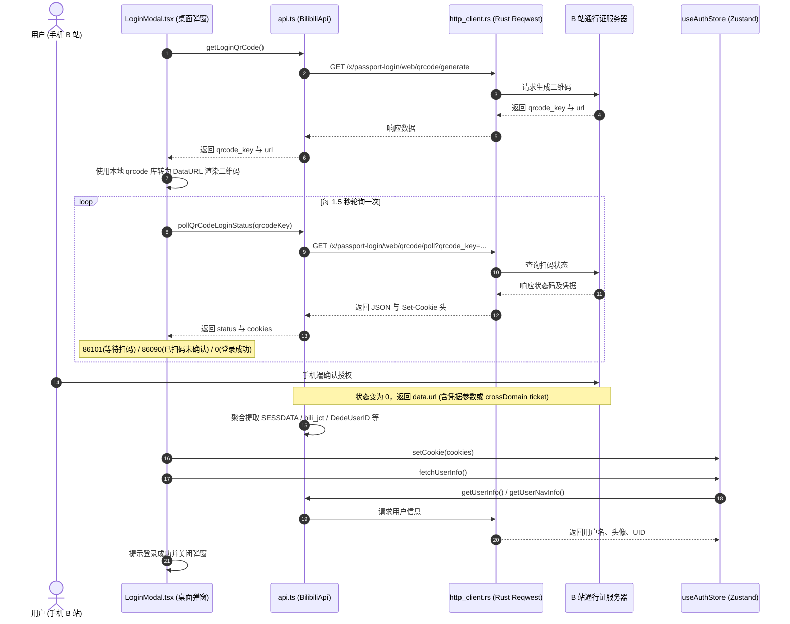
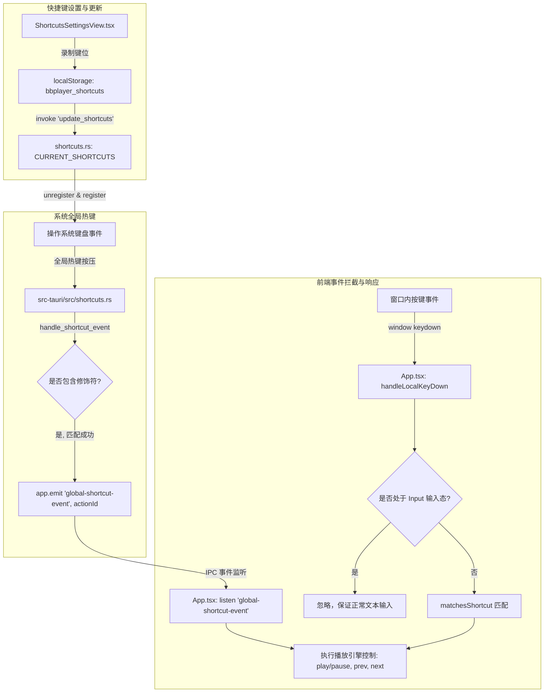

# BBPlayer 扫码登录与全局快捷键架构指南

本文档全面梳理了 BBPlayer 桌面端关于 **“B 站二维码扫码登录”** 与 **“全局 / 应用内快捷键”** 两大核心功能的系统设计、代码调用链、关键文件行号索引及故障排查要点，便于自行调试与深度定制。

---

## 一、B 站二维码扫码登录模块

### 1.1 架构与数据流时序

扫码登录采用 **“前端定时轮询 + Core 层请求 B 站接口 + AuthStore 保存凭证 + Rust 原生 HTTP 代理”** 的架构：

---

### 1.2 核心代码文件与行号索引

| 逻辑环节 | 文件路径 | 关键函数 / 位置 | 职责说明 |
| :--- | :--- | :--- | :--- |
| **前端弹窗与轮询控制** | [`apps/desktop/src/components/modals/LoginModal.tsx`](file:///G:/Project/Gemini/BBPlayer/apps/desktop/src/components/modals/LoginModal.tsx) | [`loadQrCode`](file:///G:/Project/Gemini/BBPlayer/apps/desktop/src/components/modals/LoginModal.tsx#L24-L54) | 调用 API 获取二维码凭据，并调用 `QRCode.toDataURL` 渲染本地图像 |
| | | [`useEffect` 轮询](file:///G:/Project/Gemini/BBPlayer/apps/desktop/src/components/modals/LoginModal.tsx#L62-L101) | 维护 1.5 秒计时器，调用 API 轮询，成功时驱动 Store 更新与弹窗关闭 |
| **B 站 API 与凭据聚合提取** | [`packages/shared-core/src/api/bilibili/api.ts`](file:///G:/Project/Gemini/BBPlayer/packages/shared-core/src/api/bilibili/api.ts) | [`getLoginQrCode`](file:///G:/Project/Gemini/BBPlayer/packages/shared-core/src/api/bilibili/api.ts#L697-L706) | 请求 `/x/passport-login/web/qrcode/generate` 接口 |
| | | [`pollQrCodeLoginStatus`](file:///G:/Project/Gemini/BBPlayer/packages/shared-core/src/api/bilibili/api.ts#L708-L865) | 请求 `/x/passport-login/web/qrcode/poll` 轮询接口，多源聚合 Cookie |
| | | [`getUserInfo`](file:///G:/Project/Gemini/BBPlayer/packages/shared-core/src/api/bilibili/api.ts#L413-L421) | 请求 `/x/space/myinfo` 获取个人空间信息 |
| | | [`getUserNavInfo`](file:///G:/Project/Gemini/BBPlayer/packages/shared-core/src/api/bilibili/api.ts#L423-L432) | 请求 `/x/web-interface/nav` 校验导航栏登录态与用户信息 |
| **状态持久化与状态机** | [`packages/shared-core/src/stores/useAuthStore.ts`](file:///G:/Project/Gemini/BBPlayer/packages/shared-core/src/stores/useAuthStore.ts) | [`setCookie`](file:///G:/Project/Gemini/BBPlayer/packages/shared-core/src/stores/useAuthStore.ts#L34-L57) | 校验 `bili_jct / SESSDATA`，写入 Store 与 CookieProvider |
| | | [`fetchUserInfo`](file:///G:/Project/Gemini/BBPlayer/packages/shared-core/src/stores/useAuthStore.ts#L63-L97) | 触发拉取用户信息，失败时自动向 nav 接口兜底 |
| **原生网络请求桥接** | [`apps/desktop/src/api/desktopHttpClient.ts`](file:///G:/Project/Gemini/BBPlayer/apps/desktop/src/api/desktopHttpClient.ts) | [`fetch`](file:///G:/Project/Gemini/BBPlayer/apps/desktop/src/api/desktopHttpClient.ts#L13-L71) | 拦截前端 HTTP 请求并桥接至 Rust 端 IPC |
| **Rust 端 Native HTTP Client** | [`apps/desktop/src-tauri/src/http_client.rs`](file:///G:/Project/Gemini/BBPlayer/apps/desktop/src-tauri/src/http_client.rs) | [`native_http_request`](file:///G:/Project/Gemini/BBPlayer/apps/desktop/src-tauri/src/http_client.rs#L38-L107) | 使用 reqwest 绕过浏览器同源策略，完整收集 `Set-Cookie` 响应头 |

---

### 1.3 扫码登录排查与修改建议

1. **凭证提取源校验**：
   - 当手机点击确认后，B 站返回接口外层 `code === 0`，内层 `data.code === 0`。
   - 核心参数包含：`SESSDATA`、`bili_jct`、`DedeUserID`、`DedeUserID__ckMd5`。
   - 在 [`pollQrCodeLoginStatus`](file:///G:/Project/Gemini/BBPlayer/packages/shared-core/src/api/bilibili/api.ts#L708-L865) 内可打印 `console.log('poll response data:', data)`，查看 B 站返回的结构：
     - 若 `data.url` 为直接附带 query 参数的链接，可从 URL 直接提取。
     - 若 `data.url` 为包含 `ticket` 的 crossDomain 链接，需发送 GET 请求获取其重定向响应中的 `Set-Cookie`。
2. **Cookie 持久化存储校验**：
   - 检查 [`useAuthStore.ts`](file:///G:/Project/Gemini/BBPlayer/packages/shared-core/src/stores/useAuthStore.ts#L45) 中 `isLoggedIn` 的判定条件。若仅保存了 `SESSDATA` 而 `bili_jct` 为空，登录态判定可能不成立。

---

## 二、全局与应用内快捷键模块

### 2.1 架构与事件流程

桌面端快捷键分为 **“操作系统级全局热键（后台运行/最小化时响应）”** 与 **“应用窗口内本地快捷键（单键如空格、方向键等）”** 两套互补体系：

---

### 2.2 核心代码文件与行号索引

| 逻辑环节 | 文件路径 | 关键函数 / 位置 | 职责说明 |
| :--- | :--- | :--- | :--- |
| **Rust 系统全局热键注册与派发** | [`apps/desktop/src-tauri/src/shortcuts.rs`](file:///G:/Project/Gemini/BBPlayer/apps/desktop/src-tauri/src/shortcuts.rs) | [`get_default_shortcuts`](file:///G:/Project/Gemini/BBPlayer/apps/desktop/src-tauri/src/shortcuts.rs#L12-L40) | 定义系统默认全局热键配置（如 `Alt+Shift+Space`） |
| | | [`register_all_shortcuts`](file:///G:/Project/Gemini/BBPlayer/apps/desktop/src-tauri/src/shortcuts.rs#L45-L57) | 调用 Tauri `global_shortcut` 插件向 Windows 系统 API 注册热键 |
| | | [`handle_shortcut_event`](file:///G:/Project/Gemini/BBPlayer/apps/desktop/src-tauri/src/shortcuts.rs#L59-L93) | 接收系统按键回调，匹配动作 ID，通过 `emit` 转发到前端 |
| | | [`update_shortcuts`](file:///G:/Project/Gemini/BBPlayer/apps/desktop/src-tauri/src/shortcuts.rs#L101-L109) | 动态更新并持久化活跃热键列表至静态 Mutex 缓存 |
| **Rust 插件初始化挂载** | [`apps/desktop/src-tauri/src/lib.rs`](file:///G:/Project/Gemini/BBPlayer/apps/desktop/src-tauri/src/lib.rs) | [`Builder`](file:///G:/Project/Gemini/BBPlayer/apps/desktop/src-tauri/src/lib.rs#L44-L65) | 挂载 `tauri-plugin-global-shortcut` 及其事件处理钩子 |
| **前端 IPC 监听与本地快捷键** | [`apps/desktop/src/App.tsx`](file:///G:/Project/Gemini/BBPlayer/apps/desktop/src/App.tsx) | [`listen('global-shortcut-event')`](file:///G:/Project/Gemini/BBPlayer/apps/desktop/src/App.tsx#L190-L220) | 监听 Rust 端派发的 `play_pause`、`prev_track`、`next_track` 等动作 |
| | | [`handleLocalKeyDown`](file:///G:/Project/Gemini/BBPlayer/apps/desktop/src/App.tsx#L223-L280) | 窗口内本地键盘事件拦截与 `matchesShortcut` 规则匹配（处理单键空格/切歌） |
| **快捷键录制设置面板** | [`apps/desktop/src/components/views/ShortcutsSettingsView.tsx`](file:///G:/Project/Gemini/BBPlayer/apps/desktop/src/components/views/ShortcutsSettingsView.tsx) | [`handleKeyDown`](file:///G:/Project/Gemini/BBPlayer/apps/desktop/src/components/views/ShortcutsSettingsView.tsx#L65-L95) | 捕获用户在设置界面按下的按键组合并解析为规范字符串 |
| | | [`saveShortcuts`](file:///G:/Project/Gemini/BBPlayer/apps/desktop/src/components/views/ShortcutsSettingsView.tsx#L97-L110) | 保存至 `localStorage` 并调用 `update_shortcuts` 同步至 Rust 运行时 |

---

### 2.3 快捷键排查与修改建议

1. **Windows 平台全局热键限制**：
   - Windows 的 `RegisterHotKey` API 规定，**全局操作系统热键必须包含修饰键**（`Ctrl` / `Alt` / `Shift` / `Win`）。
   - 如果用户将快捷键设置为不带修饰键的单键（如仅按 `Space` 或 `A`），Windows 系统层会直接拒绝注册全局热键。
   - 单键必须依赖 [`App.tsx` 中的 `handleLocalKeyDown`](file:///G:/Project/Gemini/BBPlayer/apps/desktop/src/App.tsx#L223-L280) 在应用窗口内激活时拦截生效。
2. **事件名称对应**：
   - Rust [`shortcuts.rs`](file:///G:/Project/Gemini/BBPlayer/apps/desktop/src-tauri/src/shortcuts.rs#L86) 发出的事件名称是 `"global-shortcut-event"`，载荷为动作标识符（`item.id`，如 `"play_pause"`）。
   - [`App.tsx`](file:///G:/Project/Gemini/BBPlayer/apps/desktop/src/App.tsx#L192) 中监听的必须也是 `"global-shortcut-event"`，分支处理中匹配相同 ID。
3. **设置项缓存同步**：
   - 前端从 `localStorage.getItem('bbplayer_shortcuts')` 读取已保存配置。
   - 修改设置后需确保触发了 `invoke('update_shortcuts', { configs })`，否则 Rust 端仍停留在旧的热键注册状态。
