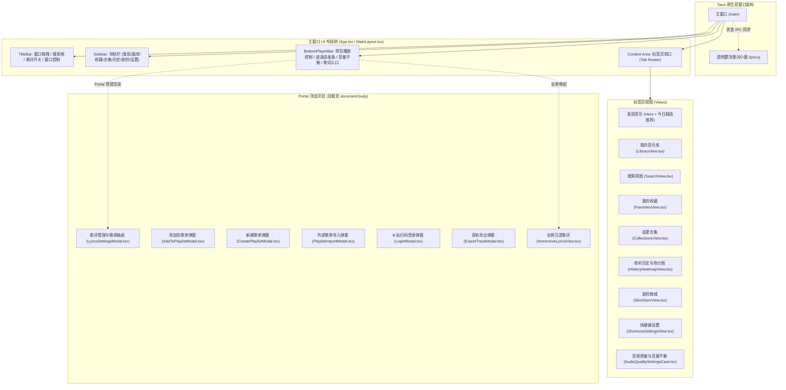
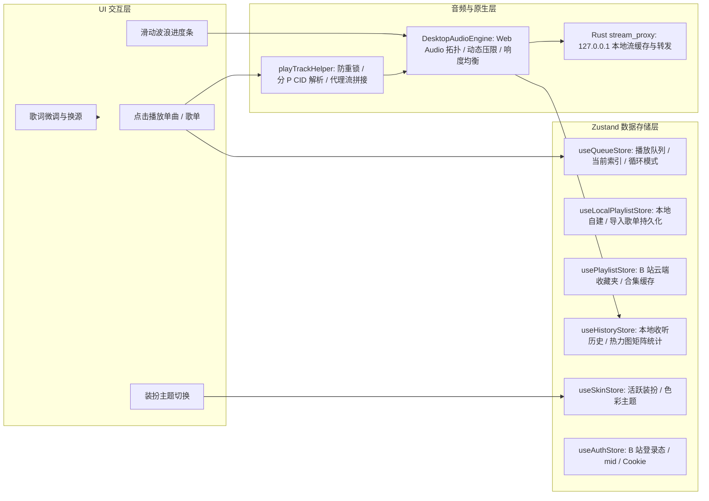

# BBPlayer 桌面端 UI 架构与排错优化开发指南

> **文档定位**：本指南用于向后续参与维护、缺陷排查（Debug）和体验优化的智能 Agent 或工程师提供完整清晰的 UI 架构图谱、核心组件边界、状态流转拓扑、已知踩坑点避坑准则以及未来优化路径。
> **关联源码归档目录**：[`G:\Project\Gemini\BBPlayer\docs`](file:///G:/Project/Gemini/BBPlayer/docs)

---

## 1. 核心架构与设计规范

### 1.1 技术栈与视效体系
* **开发框架**：Tauri v2 + React 18 + TypeScript + Vite
* **样式引擎**：Tailwind CSS + PostCSS
* **动效库**：Framer Motion + Web Animations API
* **图标系统**：Lucide React
* **材质规范**：
  - **Mica / Acrylic 半透明毛玻璃**：采用统一的 `backdrop-blur-md` / `backdrop-blur-2xl` 与深黑背景 `bg-[#0b0f17]` / `bg-background/95`；
  - **微光边框**：全站卡片与弹窗规范统一为 `border border-white/5`，鼠标悬停时激活 `hover:border-white/15`；
  - **圆角规范**：外层容器统一使用 `rounded-2xl`（16px），内部列表项/按钮统一使用 `rounded-xl`（12px），标签/徽章统一使用 `rounded-full`。
  - **动态主题色系统**：通过 CSS 全局变量 `--primary`、`--bili-theme-primary` 动态驱动，支持提取 B 站官方个性装扮主题色实时注入。

---

## 2. 全景架构拓扑与组件树



---

## 3. 核心组件清单与职责索引

| 组件文件名 | 路径 | 核心职责与设计要点 | 关键交互与调用契约 |
| :--- | :--- | :--- | :--- |
| **`App.tsx`** | `src/App.tsx` | 主应用骨架与 Tab 路由控制器；挂载各全局弹窗；维护永久 Ref 热键监听器；提供 Space 单键全局独立控制。 | 接收 `activeTab`，派发播放事件给 `desktopAudioEngine` |
| **`MainLayout.tsx`** | `src/components/layout/MainLayout.tsx` | 四段式页面骨架容器，设置深色主题背景与顶部环境光晕（Ambient Glow）。 | 组合 `TitleBar`, `Sidebar`, `BottomPlayerBar` |
| **`TitleBar.tsx`** | `src/components/layout/TitleBar.tsx` | 顶部无边框沉浸式操作栏；使用 `data-tauri-drag-region` 支持窗口拖动；提供即时搜索框与歌词窗口开关。 | 触发 `onSearch`, `onToggleLyricsWindow`, 窗口最小化/关闭 |
| **`Sidebar.tsx`** | `src/components/layout/Sidebar.tsx` | 左侧功能导航与个人中心；支持展示用户头像、大会员标识与登录入口。 | 切换 `NavTab`，唤起 `LoginModal` |
| **`BottomPlayerBar.tsx`** | `src/components/layout/BottomPlayerBar.tsx` | 底部常驻播放控制栏；集成拟物波浪进度条 `WavySlider`、音质徽章、智能音量平衡、歌词抽屉入口。 | 控制播放/暂停/切歌/音量/单曲微调抽屉 |
| **`LibraryView.tsx`** | `src/components/views/LibraryView.tsx` | 本地音乐库独立管理面板；包含自建歌单、导入歌单卡片、歌单详情、一键播放全部、单曲移除。 | 严格隔离 B 站云端收藏夹，仅操作 `useLocalPlaylistStore` |
| **`SearchView.tsx`** | `src/components/views/SearchView.tsx` | 音乐/视频搜索结果列表；支持直接播放、添加到本地歌单、导出本地音轨。 | 挂载 `AddToPlaylistModal`，支持模糊关键词搜索 |
| **`FavoritesView.tsx`** | `src/components/views/FavoritesView.tsx` | B 站云端收藏夹浏览视口；支持按用户意愿隐藏非音乐类别的收藏夹。 | 操作 `usePlaylistStore`，支持分页拉取收藏内容 |
| **`CollectionsView.tsx`** | `src/components/views/CollectionsView.tsx` | B 站追更视频合集浏览视口；支持合集过滤隐藏与连续追听。 | 联动 B 站合集/分集 API |
| **`HistoryHeatmapView.tsx`** | `src/components/views/HistoryHeatmapView.tsx` | 真实收听足迹仪表盘；基于时间戳动态生成 12 周活跃度热力图矩阵、今日指标与历史曲目回放列表。 | 联动 `useHistoryStore`，支持一键清空与单曲重听 |
| **`SkinStoreView.tsx`** | `src/components/views/SkinStoreView.tsx` | B 站个性装扮商城；实时同步装扮套装，动态提取主题色并写入 CSS 全局变量。 | 联动 `useSkinStore` |
| **`ShortcutsSettingsView.tsx`** | `src/components/views/ShortcutsSettingsView.tsx` | 全局快捷键与 Space 独立控制面板；支持键盘按键组合录制、冲突检测与恢复默认。 | 调用 Rust `update_shortcuts` 与本地存储同步 |
| **`AudioQualitySettingsCard.tsx`** | `src/components/views/AudioQualitySettingsCard.tsx` | 音频质量偏好切换面板（Hi-Res/192K/132K）以及“智能音频音量平衡”开关。 | 联动 `audioSettings.ts` 与 `desktopAudioEngine` |
| **`LyricsSettingsModal.tsx`** | `src/components/modals/LyricsSettingsModal.tsx` | 歌词管理与微调**抽屉侧边栏**（Drawer）；支持网易云/QQ音乐多源歌词搜索、逐字/逐句采用、自定义歌词粘贴及毫秒微调。 | **必须使用 `createPortal` 挂载**，防止层叠上下文遮挡 |
| **`AddToPlaylistModal.tsx`** | `src/components/modals/AddToPlaylistModal.tsx` | 添加单曲至本地歌单轻量弹窗；支持选择已有歌单或现场新建歌单并收纳。 | 联动 `useLocalPlaylistStore.addTrackToPlaylist` |
| **`PlaylistImportModal.tsx`** | `src/components/modals/PlaylistImportModal.tsx` | 外部歌单智能导入弹窗；解析网易云/QQ 音乐链接，精准模糊匹配 B 站对应视频音轨，确认后存入本地音乐库。 | 调用多级 Fallback 匹配器与本地歌单持久化 |
| **`DesktopLyricsApp.tsx`** | `src/windows/lyrics/DesktopLyricsApp.tsx` | 独立桌面悬浮歌词原生小窗；支持全透明置顶、鼠标穿透（Ignore Cursor）、双行卡拉OK染色动效。 | 监听主窗口 `lyrics-sync` IPC 事件，调用 `window_ext` |

---

## 4. 状态流转与单向数据流拓扑

BBPlayer 采用以 **Zustand** 为核心的状态分治架构，各个 Store 职责严格单一：



---

## 5. 🔥 高频陷阱与排查避坑指南 (Troubleshooting)

后续 Agent 在定位或修改代码时，**必须优先阅读本节**，避免重复引入已解决的经典缺陷：

### 陷阱 1：`backdrop-filter` 导致的 `position: fixed` 层叠上下文截断与被遮挡
* **现象**：右侧滑出抽屉（Drawer）或弹窗明明设置了 `fixed inset-0 z-50`，却无法覆盖全屏，高度被限制在底部播放栏，甚至被主内容区遮挡。
* **根因**：根据 W3C CSS 规范，当任何祖先元素设置了 `backdrop-filter: blur(...)`（例如底部播放栏的 `backdrop-blur-2xl`），浏览器会**强制为该祖先元素创建独立的包含块（Containing Block）和层叠上下文（Stacking Context）**，使子元素的 `position: fixed` 视口定位失效，转而相对于该祖先元素定位。
* **解决准则**：
  ```tsx
  // ❌ 错误示范：直接在组件内渲染
  return <div className="fixed inset-0 z-50">...</div>

  // ✅ 正确示范：使用 React Portal 挂载到根节点
  import { createPortal } from 'react-dom'
  return createPortal(
      <div className="fixed inset-0 z-[999] overflow-hidden">...</div>,
      document.body
  )
  ```

---

### 陷阱 2：首次播放音频并发重入导致播放几秒后从 0 秒重播
* **现象**：点击播放某首新歌时，歌曲刚播放 1~2 秒，突然中断并重新从 0 秒开始播放。
* **根因**：
  1. **React 状态更新与并发竞态**：卡片点击函数执行了 `setQueue`，导致 `useQueueStore` 状态更新，从而触发了播放栏中监听 `currentTrack` 的 `useEffect` 自动播放，造成两路并发调用 `playTrackWithProxy`；
  2. **`audio.src` 二次赋值**：第二次异步请求返回时，再次执行了 `this.audio.src = url`，导致正在播放中的浏览器 Audio 实例被强制清空 Buffer 重置回 0 秒；
  3. **Rust 代理坏缓存**：`stream_proxy.rs` 曾在连接异常中断时无条件将残缺的 `.part` 文件 rename 为 `.m4s`，导致浏览器读到截断的坏文件。
* **解决准则**：
  - 在 [`playTrackHelper.ts`](file:///G:/Project/Gemini/BBPlayer/apps/desktop/src/audio/playTrackHelper.ts) 中引入 `currentLoadingTrackKey` 防重互斥锁；
  - 在 [`DesktopAudioEngine.ts`](file:///G:/Project/Gemini/BBPlayer/apps/desktop/src/audio/DesktopAudioEngine.ts) 的 `loadAndPlay` 中增加校验：
    ```ts
    const isSameTrack = this.currentTrack?.uniqueKey === track.uniqueKey
    const isSameSrc = this.audio.src === proxyStreamUrl
    if (!isSameTrack || !isSameSrc) {
        this.audio.src = proxyStreamUrl // 仅在源真正变化时才重新赋值
    }
    ```
  - 严格限制 Rust 代理仅在 upstream 读取到完整的 EOF 时才重命名缓存，异常中断直接删除临时文件。

---

### 陷阱 3：Windows 全局热键失焦失效与按键吞噬
* **现象**：当 BBPlayer 处于前台时快捷键正常，一旦切换到微信、Chrome 或记事本，快捷键完全失效。
* **根因**：
  1. **系统热键冲突**：Windows 将 `Alt+Shift` 默认用作“切换输入语言”，全局热键注册直接被操作系统截获；
  2. **React Hook 依赖卸载断档**：原 `useEffect` 依赖了切歌时会变动的函数，切歌时会短暂 `delete (window as any).__triggerGlobalShortcut`，导致失焦时 IPC 丢失。
* **解决准则**：
  - 默认快捷键升级为 Windows 安全组合：`Ctrl+Alt+Space`, `Ctrl+Alt+ArrowLeft`, `Ctrl+Alt+ArrowRight`, `Ctrl+Alt+D`, `Ctrl+Alt+L`；
  - 前端使用 `useRef` 实现永久 Ref 挂载，空依赖数组只挂载一次，永不解绑；
  - 单键 `Space` 控制独立于全局快捷键，在窗口内 `keydown` 中只要不是输入框（`input`/`textarea`）且无修饰键即直接响应。

---

### 陷阱 4：“我的音乐库”与 B 站“云端收藏夹”的业务绝对隔离
* **业务定性**：
  - **我的收藏（FavoritesView）**：只展示用户 B 站账号云端的收藏夹和视频；
  - **追更合集（CollectionsView）**：只展示用户订阅追更的视频合集；
  - **我的音乐库（LibraryView）**：专属于本地自建歌单和外部导入歌单。
* **准则**：当用户进入“我的音乐库”且曲库为空时，**绝对禁止**自动拉取或把 B 站收藏夹填充到音乐库中！

---

### 陷阱 5：Chromium 原生右键浏览器菜单弹出
* **现象**：在客户端窗口内点击鼠标右键，弹出原生浏览器的“返回/重新加载/另存为/检查”菜单。
* **解决准则**：在 [`main.tsx`](file:///G:/Project/Gemini/BBPlayer/apps/desktop/src/main.tsx) 入口中添加全局事件拦截：
  ```ts
  document.addEventListener('contextmenu', (e) => e.preventDefault())
  ```

---

## 6. 后续演进与体验优化路线图

后续接入的 Agent 可以针对以下方向开展深度优化：

1. **大列表虚拟滚动 (Virtual Scrolling)**：
   - 现阶段 [`LibraryView.tsx`](file:///G:/Project/Gemini/BBPlayer/apps/desktop/src/components/views/LibraryView.tsx) 和 [`FavoritesView.tsx`](file:///G:/Project/Gemini/BBPlayer/apps/desktop/src/components/views/FavoritesView.tsx) 为全量 DOM 渲染；
   - 当歌单歌曲超过 500 首时，推荐接入 `@tanstack/react-virtual` 进行视口虚拟化渲染，将长列表滚动帧率锁定在 60 FPS。
2. **封面图片加载容错与渐进过渡**：
   - 当前针对 B 站防盗链采用了 `referrerPolicy="no-referrer"`；
   - 建议增加轻量占位骨架屏（Skeleton Loader）与图片加载失败时的优雅降级重试。
3. **Web Audio 节点生命周期优化**：
   - 当前 `AudioContext` 采用单例驻留；切歌时通过 `GainNode.gain.setTargetAtTime` 实现了平滑过渡。如果后续增加均衡器（EQ 8-Band），建议封装为链式可插拔 Node 拓扑管道。
4. **全屏歌词流体背景性能调优**：
   - [`FluidBackground.tsx`](file:///G:/Project/Gemini/BBPlayer/apps/desktop/src/components/player/FluidBackground.tsx) 使用了大半径 CSS `blur(80px)`，在极低配集成显卡机型上可能占用 GPU；可探索利用 WebGL Canvas 或缩放离屏 Canvas 渲染提升渲染效率。

---

### 7. 本地文档与代码对应索引
本指南对应的一式一份完整源码归档位于本地开发目录：
`G:\Project\Gemini\BBPlayer\docs\`，可随时直接检索查验。
