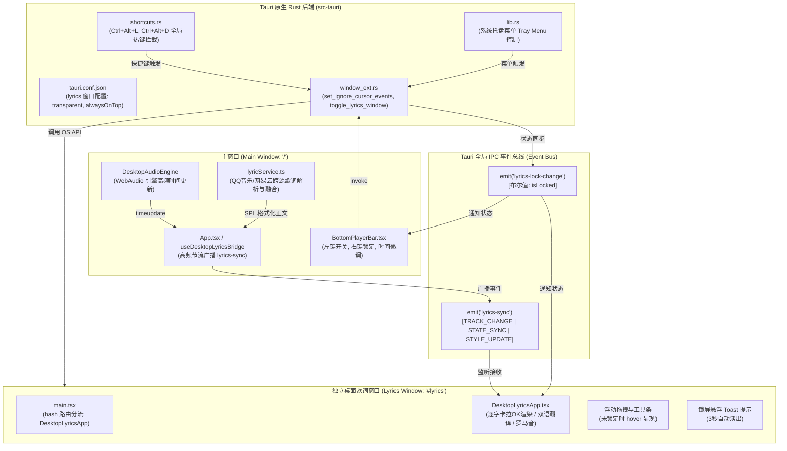

# Bili Player 桌面歌词（Desktop Floating Lyrics）系统架构与逻辑全景文档

> **文档定位**：本文档旨在系统化阐述 Bili Player 桌面端独立悬浮歌词窗口的完整技术架构、跨进程/跨窗口 IPC 通信协议、操作系统级鼠标穿透与锁定控制、逐字卡拉 OK 动效渲染以及多语言歌词融合机制，供 AI 架构评审、技术重构与开发者协同审视。

---

## 一、 系统架构总览

Bili Player 的桌面歌词采用 **Tauri v2 多窗口架构（Multi-Window Architecture）** 实现。桌面歌词运行在一个与主应用界面完全隔离、但同属一个底层宿主进程的独立 WebView 窗口中。



---

## 二、 核心子系统与关键机制

### 2.1 独立窗口配置与路由分流

#### 1. Tauri 窗口声明 (`tauri.conf.json`)
桌面歌词窗口在宿主启动时以预创建方式存在，保持独立属性：
- **`label`**: `"lyrics"`
- **`url`**: `"index.html#lyrics"`
- **`transparent`**: `true`（启用系统级透明通道，支持 Alpha 渐变与异形玻璃透明）
- **`decorations`**: `false`（彻底移除系统原生标题栏与四周边框）
- **`alwaysOnTop`**: `true`（置于所有常规桌面软件和全屏窗口之上）
- **`skipTaskbar`**: `true`（不污染 Windows 任务栏，仅在托盘和主窗口可见）
- **`visible`**: `false`（默认隐藏，按需呼出）

#### 2. 前端单页面路由分流 (`main.tsx`)
```tsx
const isLyricsWindow = window.location.hash.includes('lyrics')

ReactDOM.createRoot(document.getElementById('root') as HTMLElement).render(
    <React.StrictMode>
        {isLyricsWindow ? <DesktopLyricsApp /> : <App />}
    </React.StrictMode>
)
```
- **架构优势**：主窗口与桌面歌词共享同一个前端构建包，组件与 SPL 解析库零重复打包；
- **隔离优势**：主窗口无论进行复杂的页面切换、路由跳转或播放列表渲染，均不会引发桌面歌词的重渲染；反之，桌面歌词 60fps/144fps 的逐字渲染也绝不占用主窗口 UI 线程。

---

### 2.2 鼠标穿透、锁定与多维解锁机制

这是桌面歌词最核心也最复杂的操作系统级交互设计。

#### 1. 穿透原理（Windows OS 级）
在 `window_ext.rs` 中，通过调用底层 Windows 窗口 API 实现：
```rust
#[tauri::command]
pub fn set_ignore_cursor_events(app: AppHandle, window: WebviewWindow, ignore: bool) -> Result<(), String> {
    crate::shortcuts::LYRICS_IGNORE_CURSOR.store(ignore, std::sync::atomic::Ordering::SeqCst);
    let _ = app.emit("lyrics-lock-change", ignore);
    window.set_ignore_cursor_events(ignore).map_err(|e| e.to_string())
}
```
- 当 `ignore = true` 时，Windows 系统会向该窗口附加 `WS_EX_TRANSPARENT` 扩展样式。
- **物理现象**：操作系统的鼠标事件（MouseMove、MouseDown、MouseUp、DoubleClick、Click）会**直接穿透**歌词窗口，被底层的桌面图标、浏览器、办公软件或游戏捕获。

#### 2. 锁定状态下的无边框透明设计
在 `DesktopLyricsApp.tsx` 中：
```tsx
<div
    className={`w-screen h-screen flex flex-col justify-center items-center px-6 relative select-none rounded-2xl transition-all duration-300 group ${
        isLocked
            ? 'bg-transparent border-0 border-transparent shadow-none ring-0 outline-none'
            : 'bg-black/60 hover:bg-black/75 border border-white/10 backdrop-blur-xl shadow-[0_20px_50px_rgba(0,0,0,0.8)]'
    }`}
    style={{
        background: isLocked ? 'transparent' : undefined,
        backgroundColor: isLocked ? 'transparent' : undefined,
        boxShadow: isLocked ? 'none' : undefined,
        borderColor: isLocked ? 'transparent' : undefined,
        borderWidth: isLocked ? '0px' : undefined,
        outline: 'none',
        backdropFilter: isLocked ? 'none' : undefined,
    }}
>
```
- **锁定状态**：背景 100% 透明，完全移除边框、外发光、阴影和毛玻璃效果，歌词文字通过 `drop-shadow` 多层黑边描边确保在任何复杂壁纸下高清晰可读。
- **未锁定状态**：呈现精致暗黑玻璃拟态卡片，悬浮显示顶部拖拽栏（`data-tauri-drag-region`）、歌曲简报、快速锁定锁形图标及关闭按钮。

#### 3. 穿透交互困境与多维解锁策略
当窗口进入完全穿透状态后，前端 DOM 事件理论上不再能接收鼠标点击。系统提供了**四位一体的立体式解锁通道**：
1. **全局快捷键兜底（最高优先级）**：  
   `Ctrl + Alt + L`（由 Rust 全局底层键盘钩子捕获，不依赖窗口焦点或鼠标坐标）；
2. **系统托盘快捷操作**：  
   右键 Windows 任务栏右下角托盘图标 -> 点击“锁定/解锁桌面歌词”；
3. **主播放器底栏控制**：  
   在主界面底栏右侧桌面歌词图标上右键单击；
4. **前端双击事件探测**：  
   在 `DesktopLyricsApp.tsx` 的歌词容器上绑定 `onDoubleClick={toggleLock}`。

---

### 2.3 IPC 高频同步数据协议

主窗口与桌面歌词窗口通过 Tauri IPC Event 机制进行解耦通信。

```typescript
export type LyricsSyncEvent =
    | {
            type: 'TRACK_CHANGE'       // 曲目切换与歌词全量换新
            splContent?: string        // SPL/YRC/LRC 纯文本
            durationMs: number         // 歌曲总毫秒
            title: string              // 标题（支持多分 P [P2] 格式化）
            artist: string             // 歌手名
      }
    | {
            type: 'STATE_SYNC'         // 高频进度驱动（节流 200ms）
            isPlaying: boolean         // 是否播放中
            currentTimeMs: number      // 叠加了用户微调 Offset 后的毫秒级真实时间
            timestamp: number          // 发送端基准时间戳，用于消除 IPC 网络延迟抖动
      }
    | {
            type: 'STYLE_UPDATE'       // 样式外观动态调整
            fontSize: number           // 主歌词文字大小 (px)
            primaryColor: string       // 高亮主色调 (e.g. #00AEEC)
            lockMouse: boolean         // 锁定状态
      }
```

---

### 2.4 逐字卡拉 OK 动效与多语言排版渲染

桌面歌词支持渲染三层复合文本结构：

```
[第 1 行 - 可选] 罗马音注音 (Romaji):   tsu yo ku na re ru ri yuu wo shi tta
[第 2 行 - 核心] 主歌词 (Syllable):     強 く な れ る 理 由 を 知 っ た
[第 3 行 - 可选] 中文翻译 (Translation): 我已明了能让我变坚强的理由
```

#### 1. 逐字平滑高亮算法
对于包含音节时间戳（SPL / YRC）的动态行，采用 CSS 线性渐变文字遮罩：
```tsx
const fillPct = currentTimeMs >= span.endTime
    ? 100
    : currentTimeMs > span.startTime
    ? Math.min(100, ((currentTimeMs - span.startTime) / (span.duration || 1)) * 100)
    : 0

<span
    style={{
        background: `linear-gradient(to right, ${primaryColor} ${fillPct}%, rgba(255, 255, 255, 0.92) ${fillPct}%)`,
        WebkitBackgroundClip: 'text',
        WebkitTextFillColor: 'transparent',
    }}
>
    {span.text}
</span>
```
- **性能优势**：完全基于 GPU 硬件加速的着色器渲染，不触发布局抖动（Reflow）；
- **动态降级**：若为标准 LRC 句子级歌词，自动平滑退化为单句颜色激活与发光投影。

---

## 三、 相关源文件全景映射

| 模块类别 | 代码库原始路径 | 本目录备份路径 | 核心职责 |
| :--- | :--- | :--- | :--- |
| **独立视图** | `apps/desktop/src/windows/lyrics/DesktopLyricsApp.tsx` | [`src/windows/lyrics/DesktopLyricsApp.tsx`](./src/windows/lyrics/DesktopLyricsApp.tsx) | 桌面歌词独立窗口 UI、逐字动效、双击解锁、状态渲染 |
| **窗口路由** | `apps/desktop/src/main.tsx` | [`src/main.tsx`](./src/main.tsx) | 单页面 hash 路由分流 (`#lyrics`) |
| **跨窗口桥接** | `apps/desktop/src/App.tsx` | [`src/App_lyrics_snippet.tsx`](./src/App_lyrics_snippet.tsx) | 主窗口音频状态节流广播与事件发送逻辑 |
| **交互控制** | `apps/desktop/src/components/layout/BottomPlayerBar.tsx` | [`src/components/BottomPlayerBar_lyrics_snippet.tsx`](./src/components/BottomPlayerBar_lyrics_snippet.tsx) | 底栏图标左键显隐、右键锁定 |
| **歌词引擎** | `apps/desktop/src/services/lyricService.ts` | [`src/services/lyricService.ts`](./src/services/lyricService.ts) | 多源歌词抓取、跨源罗马音/翻译互补与 SPL 组装 |
| **原生命令** | `apps/desktop/src-tauri/src/window_ext.rs` | [`src-tauri/window_ext.rs`](./src-tauri/window_ext.rs) | Windows API 鼠标穿透、窗口显隐原生实现 |
| **全局热键** | `apps/desktop/src-tauri/src/shortcuts.rs` | [`src-tauri/shortcuts.rs`](./src-tauri/shortcuts.rs) | 全局底层键盘钩子拦截与锁定状态同步 |
| **窗口元配置** | `apps/desktop/src-tauri/tauri.conf.json` | [`src-tauri/tauri.conf.json`](./src-tauri/tauri.conf.json) | 透明度、置顶、任务栏隐藏等窗口声明 |
| **托盘联动** | `apps/desktop/src-tauri/src/lib.rs` | [`src-tauri/lib.rs`](./src-tauri/lib.rs) | 系统托盘菜单事件路由与命令注册 |

---

## 四、 常见边界情况与架构审视点（供 AI 评审关注）

1. **高频 IPC 开销与性能平衡**：
   - 目前在 `App.tsx` 中采用 200ms 节流发送 `STATE_SYNC`；
   - *审视点*：桌面歌词依靠高频 `currentTimeMs` 推动逐字动画。若直接依靠 200ms 事件推动，微观下可能存在肉眼可见的步进停顿。当前方案是否应在桌面歌词侧引入基于本地 `requestAnimationFrame` + `performance.now()` 的插值时钟预测（Clock Interpolation）？
2. **鼠标穿透下的 Windows 双击判定**：
   - 在启用 `WS_EX_TRANSPARENT` 后，Windows 内核直接跳过该窗口做 Hit-Test，导致前端 `onDoubleClick` 在部分系统版本上彻底收不到事件；
   - *审视点*：目前主要依靠全局快捷键 `Ctrl+Alt+L` 和系统托盘进行 100% 可靠解锁。是否有必要在 Rust 端引入全局鼠标双击微钩子以提升穿透状态下的鼠标纯手势解锁体验？
3. **跨多源歌词时间轴漂移对齐**：
   - 当使用 QQ 音乐主歌词并从网易云补充罗马音时，二者音轨可能存在几百毫秒的版本差异；
   - *审视点*：`lyricService.ts` 中的 `findClosestInMap(timeMs, map, toleranceMs = 400)` 采用了 400ms 容差临近匹配算法，是否足够应对绝大多数 live 版与录音室版的微小时间差？
