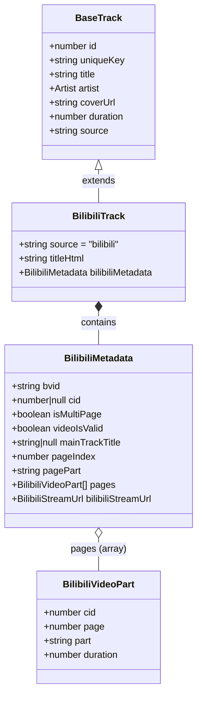
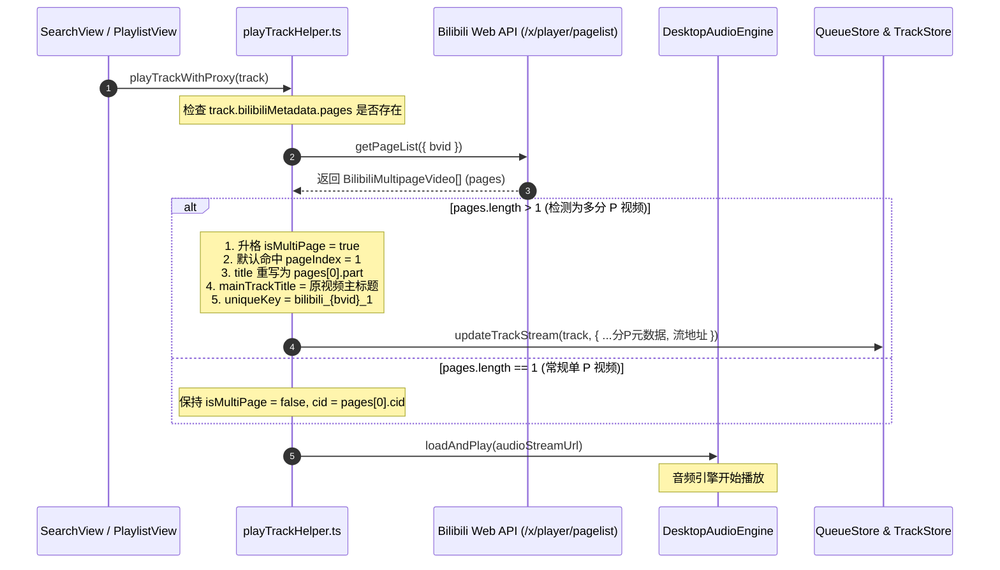
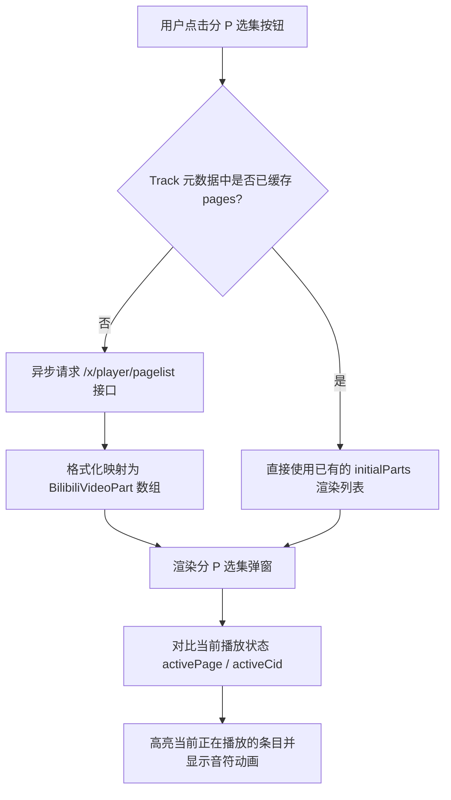
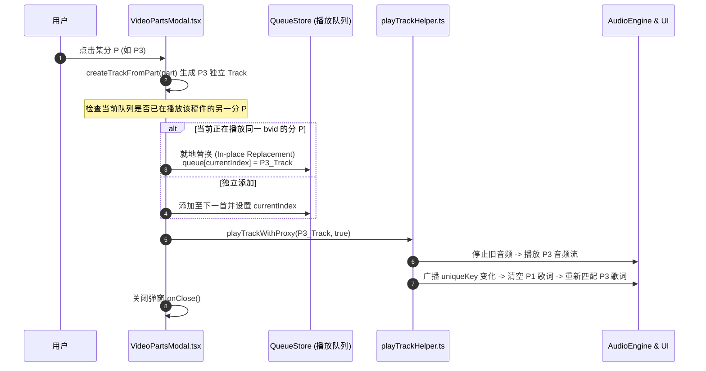

# Bili Player 视频分 P (Multi-page) 架构与结构逻辑全景文档

> 本文档详细阐述了 **Bili Player** 桌面音乐播放器中，关于 **Bilibili 视频分 P (Multi-part / Multi-page)** 的数据结构设计、底层 API 交互、播放流转生命周期、选集 UI 交互机制以及跨组件状态同步逻辑，专供架构审查与 AI 分析使用。

---

## 1. 业务背景与问题定义

### 1.1 什么是 B 站分 P 视频？
在 Bilibili 平台中，视频由唯一的稿件编号 `bvid`（例如 `BV1xx411c7Xz`）标识。
- **单 P 视频**：该稿件下仅包含 1 个视频/音频流片段，对应 1 个 `cid`（Content ID）。
- **多分 P 视频**：UP 主在一个稿件下上传了多个独立的视频章节（如：专辑歌曲合集、演唱会整场切片、番剧剧集等）。
  - 每个分 P 拥有独立的：
    - `page`: 分 P 序号（从 1 开始）；
    - `cid`: 该分 P 独立的流内容标识符（流媒体播放的真正核心 key）；
    - `part`: 该分 P 的副标题（例如 `01. 晴天`、`02. 轨迹`）；
    - `duration`: 该分 P 的精准时长（秒）。

### 1.2 音乐播放器场景下的核心矛盾
普通流媒体音乐软件（如网易云、QQ音乐）的数据模型是 `1 Song = 1 Track`。
而在以 B 站为音源的播放器中：
1. **搜索或推荐拉取的是“稿件”**：B 站搜索接口 `/x/web-interface/search/type` 或推荐接口返回的通常只是 `bvid` 和视频主标题，**不携带具体的分 P 列表与每个分 P 的 `cid`**。
2. **播放的实体是具体的分 P**：B 站音视频流接口 `/x/player/wbi/playurl` 必须同时传入 `bvid` 和 `cid`。若没有 `cid`，无法精准获取目标音频流。
3. **播放列表与切歌语义**：
   - 用户可能只想把这整个视频当成“一首歌”（默认听 P1）；
   - 用户也可能打开选集，把这个视频中的“P2”挑选出来听；
   - 用户还可能点击“播放全部分 P”，将这整张专辑（例如 10 个分 P）展开为播放列表中的 10 首独立歌曲。

---

## 2. 核心数据模型 (Data Models)

### 2.1 实体关系模型



### 2.2 核心字段解析
在 TypeScript 中（见 `src/types/media.ts`）：
- **`uniqueKey`（音轨唯一键）**：
  - 单 P 视频：`bilibili_${bvid}_0` 或 `bilibili:${bvid}`。
  - 分 P 视频：`bilibili_${bvid}_${pageIndex}`（如 `bilibili_BV1xx_2`）。
  - *设计作用*：确保切换不同分 P 时，`uniqueKey` 发生物理变化，从而触发 React `useEffect([track.uniqueKey])`，正确复位歌词、高亮选集、隔离不同分 P 的本地播放进度与歌词偏移。
- **`mainTrackTitle`（主视频标题）**：
  - 当视频被识别为分 P 时，保留视频投稿的主标题（例如《周杰伦经典专辑无损合辑》）。
- **`title`（当前音轨标题）**：
  - 如果是分 P，`track.title` 会被重写为分 P 标题（例如 `01. 晴天`）。
- **`pageIndex` & `pagePart`**：
  - 标识当前正在播放的第几 P（从 1 开始计数）及分 P 命名。
- **`pages`**：
  - 缓存在该 Track 元数据内的全量分 P 数组 `BilibiliVideoPart[]`，避免后续重复请求 B 站 API。

---

## 3. 全链路流转与交互架构 (Flows & Sequences)

### 3.1 场景一：从搜索/推荐直接播放整视频（分 P 懒加载识别）

当用户从搜索结果中点击播放一个稿件时，初始化传入的只是一个普通 `Track`（`isMultiPage: false, cid: null`）。在真正触发播放的调度函数 `playTrackWithProxy` 中进行异步分 P 探测与元数据升格：



---

### 3.2 场景二：用户打开分 P 选集弹窗 (`VideoPartsModal.tsx`)

用户在播放底栏点击 `[P1/10]` 按钮，或在搜索列表点击分 P 按钮：



---

### 3.3 场景三：选集弹窗内点击切换单个分 P（就地替换机制）

用户在分 P 选集中点击切换其他分 P（例如从 P1 点击 P3）：



> **设计亮点（就地替换）**：
> 如果用户在一个 20 分 P 的视频中连续点切 P2、P3、P4，不会在播放队列中堆叠大量重复的稿件条目，而是直接原地替换当前正在播放的音轨，保持播放队列整洁。

---

### 3.4 场景四：批量播放全部分 P vs 全部追加

在 `VideoPartsModal` 顶部提供两个批量操作入口：
1. **播放全部分 P (`handlePlayAllParts`)**：
   - 将全量 `parts: BilibiliVideoPart[]` 映射为 `N` 个独立的 `BilibiliTrack`；
   - 调用 `setQueue(allTracks, 0)`，直接将当前播放队列彻底重设为这整张合集的所有分 P，并从 P1 自动播放到最后一 P。
2. **追加全部 (`handleAppendAllParts`)**：
   - 将所有分 P 循环调用 `addTrack(track, false)`，顺序追加到当前播放列表的最末尾，不打断当前播放。

---

## 4. UI 呈现与状态联动规范

为了在任何界面都能清晰感知分 P 状态，播放器在以下核心视图统一了标题格式化规则：

### 4.1 标题渲染标准格式
```typescript
const displayTitle = biliTrack?.bilibiliMetadata?.isMultiPage && 
                     (biliTrack.bilibiliMetadata.pagePart || biliTrack.bilibiliMetadata.pageIndex)
    ? `[P${biliTrack.bilibiliMetadata.pageIndex || 1}] ${biliTrack.bilibiliMetadata.pagePart || track.title}`
    : track.title
```

| 组件界面 | 渲染方式 | 说明 |
| :--- | :--- | :--- |
| **底栏播放条 (`BottomPlayerBar.tsx`)** | `[P1] 01. 晴天`<br/>右侧挂载 `[P1/10]` 胶囊选集按钮 | 点击胶囊按钮直接弹出选集弹窗；悬浮 Tooltip 显示：`主标题 · [P1] 01. 晴天` |
| **沉浸式歌词 (`ImmersiveLyricsView.tsx`)** | 主标题：`[P1] 01. 晴天`<br/>副标题：`周杰伦经典专辑合集` | 左侧唱片区域清晰区分当前分 P 与主专辑 |
| **桌面悬浮歌词 (`DesktopLyricsApp.tsx`)** | `[P1] 01. 晴天` | 通过 `lyrics-sync` 事件广播跨进程同步 |
| **搜索与歌单列表 (`SearchView.tsx`)** | 条目右侧展示 `Layers` 选集图标按钮 | 点击即可直接预览该视频的分 P 章节列表并点播 |

---

## 5. 核心代码职责矩阵

| 文件路径 (相对本目录 `other/src/`) | 对应项目实际源码路径 | 职责定位与核心逻辑 |
| :--- | :--- | :--- |
| `types/media.ts` | `packages/shared-core/src/types/media.ts` | 核心类型模型：定义 `BilibiliVideoPart`、`BilibiliTrack`、`bilibiliMetadata` |
| `components/VideoPartsModal.tsx` | `apps/desktop/src/components/modals/VideoPartsModal.tsx` | 分 P 选集交互弹窗：列表渲染、单 P 切换、队列就地替换、批量入队 |
| `audio/playTrackHelper.ts` | `apps/desktop/src/audio/playTrackHelper.ts` | 播放调度中枢：懒加载识别分 P、重写 `title` / `duration` / `uniqueKey`、拉取音轨流 |
| `components/BottomPlayerBar_multipart.tsx` | `apps/desktop/src/components/layout/BottomPlayerBar.tsx` | 底栏分 P 标题格式化渲染与分 P 选集唤起按钮切片 |
| `components/ImmersiveLyricsView_multipart.tsx` | `apps/desktop/src/components/player/ImmersiveLyricsView.tsx` | 全屏歌词视图中分 P 标题与主稿件标题切片 |
| `api/bilibili_pagelist_api.ts` | `packages/shared-core/src/api/bilibili/api.ts` | 底层 HTTP 请求：`/x/player/pagelist` 与 `/x/player/wbi/playurl` |
| `db/schema_bilibili_metadata.ts` | `packages/shared-core/src/db/schema.ts` | SQLite 数据库持久化表：`bilibili_metadata` 结构映射 |
| `docs/TECHNICAL_DEBT_MULTIPART.md` | `apps/mobile/docs/TECHNICAL_DEBT.md` | 历史技术债记录：B 站分 P 去重成本与 API 限制备忘 |

---

## 6. 历史踩坑与演进记录 (Gotchas & Fixes)

1. **标题永远停留在第一 P 的问题**：
   - *原因*：早先分 P 切换仅修改了底层播放器的播放 URL，但没有重写 `track.title` 和 `track.bilibiliMetadata.pageIndex`，导致播放队列和底栏仍显示旧标题。
   - *解决方案*：切换分 P 时由 `createTrackFromPart` 重新生成带有新 `uniqueKey`、`title = part.part`、`pageIndex = part.page` 的完整对象并替换队列条目。
2. **弹窗中当前播放条目无法高亮或漂移**：
   - *原因*：弹窗直接信任传入的 props，但切歌后 props 存在异步闭包陈旧问题。
   - *解决方案*：弹窗内部通过 `useCurrentTrack()` 实时获取当前正在播放的音轨，优先以 `activeBiliTrack.bilibiliMetadata.pageIndex` 作为高亮依据。
3. **切换分 P 歌词不重置/串歌词**：
   - *原因*：如果 `uniqueKey` 始终是 `bilibili_${bvid}`，React `useEffect` 不会触发。
   - *解决方案*：将 `uniqueKey` 设计为 `bilibili_${bvid}_${page}`，切歌时 `uniqueKey` 发生物理改变，瞬间清空歌词并以新的副标题重新发起智能歌词检索。

---

## 7. 供其他 AI 探讨与演进的分析方向

其他 AI 在审查本项目时，可着重探讨以下几个架构演进课题：
1. **本地数据库持久化标准**：
   - 目前在导入歌单（如收藏夹）时，若提前对每个视频批量调用 `pagelist` 会带来严重的高并发风控封禁风险。如何更优雅地在后台低频消费队列中对多分 P 视频进行懒展开？
2. **多 P 视频在“随机播放”模式下的策略**：
   - 随机播放时，是把一个稿件视为一首整体，还是允许在稿件的分 P 之间随机跳转？
3. **分 P 视频的离线下载与音频缓存命名规范**：
   - 离线下载 `.m4a` 时，如何建立分 P 文件的索引与标签元数据（ID3 tag / MP4 atoms）映射。
